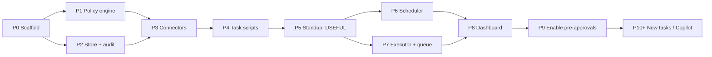

# `bot` Implementation Roadmap (High Level)

> **Scope note:** This is a **phase-level roadmap**, deliberately not a task-level plan.
> Each phase gets its own detailed, TDD-structured plan document (with exact files, test
> code, and commands) *at the time we start it* — writing that detail for all nine phases now
> would produce a large document that goes stale before it is executed.

**Goal:** A scheduled personal automation runner that observes my Jira/git/GitHub state, proposes actions, and — only under explicit, expiring, rate-limited pre-approval — performs them, with a full audit trail and a local dashboard.

**Architecture:** Pure task functions emit `Action` objects; a policy engine decides allow/queue/deny; an executor is the only component with side effects. JSONL store is the single source of truth shared by the CLI, the launchd agent, and the dashboard.

**Tech Stack:** TypeScript, Node v24.18.0 (ESM), `tsx` for direct script execution, Vitest, Vite + React (dashboard), launchd (scheduling), `gh` 2.97.0 (GitHub), Jira DC REST v2, Copilot CLI 1.0.81 (later phases).

**Source spec:** [DESIGN.md](../../../DESIGN.md)

---

## Phase overview

| # | Phase | Delivers | Depends on |
|---|---|---|---|
| P0 | Scaffold & toolchain | Repo builds, tests run, config schema | — |
| P1 | Core + policy engine | Pre-approval logic, fully unit-tested, no I/O | P0 |
| P2 | Store, audit & retention | JSONL append/read, pruning, audit records | P0 |
| P3 | Connectors & `doctor` | Jira, git, GitHub reads against fixtures | P1, P2 |
| P4 | Standalone task scripts | Three independently runnable scripts | P3 |
| P5 | **Composite standup + reports** | **First genuinely useful output** | P4 |
| P6 | Scheduler | launchd, quiet hours, sleep/offline catch-up | P5 |
| P7 | Executor & queue | Actions queued; approve via CLI | P5 |
| P8 | Dashboard | Full control surface + audit navigation | P6, P7 |
| P9 | Enable first pre-approvals | Operational, not code | P8 |
| P10+ | New tasks & Copilot automation | Sprint hygiene, PR feedback, autonomous dev | P9 |

**Two boundaries worth naming:**
- **P0–P5 is the POC.** At the end of P5 you have a real, useful, entirely read-only tool. That is the checkpoint where you verify the plan was right before any write machinery is exercised.
- **Nothing mutates anything until P9.** P7 builds the executor but every action lands in the queue; P8 lets you approve manually. Automated mutation only begins when you deliberately enable a rule.

---

## P0 — Scaffold & toolchain

**Delivers:** TypeScript ESM project, Vitest, `tsx`, lint, `.gitignore` (`data/`, `reports/`, `node_modules/`), `config.json` schema + loader with validation.

**Exit criteria:** `npm test` runs (green, trivially); `npx tsx --version` works; committing does not stage `data/` or `reports/`.

**Watch for:** Node 24 ESM + TypeScript resolution is the usual source of friction here. Settle it in P0, not while debugging a connector.

---

## P1 — Core domain & policy engine

**Delivers:** `Task`, `Action`, `Capability`, `PolicyRule` types; `evaluate(action, rules, usage, now)`; hardcoded denylist.

**Exit criteria:** Table-driven tests prove: denylist beats every rule; expired rule → queue; missing rule → queue (never allow); `perRun`/`perDay` limits enforced from history; predicate matching; injected clock (no `Date.now()` inside).

**Why first:** It is the safety-critical component *and* the easiest to test — pure, no network, no git. If this is wrong, everything downstream is unsafe. Highest value per unit of effort in the whole plan.

---

## P2 — Store, audit trail & retention

**Delivers:** Append/read for `runs.jsonl`, `actions.jsonl`, `queue.jsonl`; `rules.json` and `config.json` atomic writes (temp + rename); per-stream retention pruning.

**Exit criteria:** Concurrent appends don't interleave-corrupt; pruning respects **different windows per stream** (30d logs, 365d applied mutations — see spec §8); pruning never deletes a record referenced by an unresolved queue entry; pruning is itself audited.

**Design constraint:** Every applied action records `authorizedBy: <ruleId>`, the run that produced it, the exact payload, and the outcome. Without provenance the audit view in P8 cannot answer "why did it do that".

---

## P3 — Connectors & `bot doctor`

**Delivers:** `jira.ts`, `git.ts`, `github.ts` (read-only paths only); `copilot.ts` as interface + stub; `bot doctor`.

**Exit criteria:** Connector tests pass against **committed fixtures captured from the real APIs**, not hand-written guesses. `bot doctor` exits 0 in a healthy environment and non-zero with an actionable message for each failure mode.

**Must verify live before coding (spec §2):** the Jira DC search endpoint, request shape, pagination, and response fields — none of these are currently verified. Same for which `--json` fields `gh pr list` supports on `github.corp.clover.com`, since GHE lags github.com.

**`doctor` must check:** token presence, Jira reachability, `gh auth status`, **token scopes** (currently `repo`/`read:org` — no `write:org`, no `workflow`), repo paths, `data/` writability, launchd agent loaded, **and it must be runnable from inside the launchd environment**, which is where credential problems actually surface.

---

## P4 — Standalone task scripts

**Delivers:** `scripts/jira-standup.ts`, `scripts/branch-hygiene.ts`, `scripts/pr-status.ts` — each independently runnable, `--dry-run` default, `--json` supported.

**Exit criteria:** Each script runs alone against real data and produces sane output. Task modules are pure (`collect() → TaskResult`) and tested against fakes.

**This is the "so I can test myself" requirement.** Scripts share the production code path — testing a script tests real behaviour, not a parallel implementation.

---

## P5 — Composite standup + reporters — **POC checkpoint**

**Delivers:** `standup` task merging all three collectors; `ConsoleReporter` + `FileReporter` behind a `Reporter` interface (Slack slots in later); ticket↔PR correlation.

**Exit criteria:** `bot run standup` produces a digest that is actually worth reading, and emits (queued, unexecuted) proposed actions so you can judge their quality before enabling anything.

**Ticket resolution:** assignee/reporter/watcher, correlated with branches and PRs I authored, ranked by PR linkage. A partial run (Jira down, git fine) reports the gap explicitly rather than silently omitting a section.

**Stop here and evaluate.** If the digest isn't useful, later phases only automate something not worth automating.

---

## P6 — Scheduler: quiet hours & recovery

**Delivers:** launchd plist template + `install.sh`/`uninstall.sh`; catch-up logic; suppressed-vs-missed slot accounting.

**Exit criteria:** Agent fires on the hour 07:00–22:00 and never 23:00–06:00; a run missed by sleep produces exactly **one** coalesced catch-up on wake; quiet-hour slots are recorded `suppressed` and never caught up; an offline run doesn't advance `lastSuccessfulRun`.

**Grounded decision:** `StartCalendarInterval` (array, one dict per waking hour), **not** `StartInterval`. Per `man launchd.plist`, `StartInterval` misses firings across sleep, while `StartCalendarInterval` runs on wake and coalesces. Quiet hours come free from the hour list rather than from waking up and deciding to do nothing.

---

## P7 — Executor & approval queue

**Delivers:** Executor applying policy decisions; `bot queue list|approve|reject`; write-capable connector methods (still gated).

**Exit criteria:** With zero enabled rules, every proposed action lands in `queue.jsonl` and `actions.jsonl` shows a `QUEUE` decision — **nothing is applied**. `--apply` does not bypass policy. Denylist violations are rejected in tests (attempt to push `main`, `--force`, `--no-verify`, PR without a Jira link).

---

## P8 — Dashboard

**Delivers:** JSON API bound to `127.0.0.1`; Vite + React SPA with Jobs, Approval inbox, Rules, Settings, Audit.

**Exit criteria:**
- Approve a queued action end-to-end and see it applied and audited
- "Always approve like this" generates a **pre-filled, editable** rule showing predicate, limits, and expiry before saving
- Every setting in spec §11 is editable from the UI, written atomically and schema-validated
- **The cron job runs correctly with the dashboard never started** — config file is the contract, the dashboard is not a dependency
- Audit view filters by date/task/capability/decision, isolates applied mutations, and answers both "what did the bot change today" and "what did rule X ever authorize"

---

## P9 — Enable first pre-approvals

Not a coding phase. Review real queued actions accumulated since P5, then enable rules one at a time, lowest-risk first (`jira:assign` → `jira:comment` → `jira:transition`), each with a short expiry initially. `git:push` and `github:pr-create` are recommended to stay queued indefinitely.

**Exit criteria:** At least one rule enabled, and the audit view demonstrably shows what it authorized.

---

## P10+ — Additional tasks & Copilot automation

Each gets its own spec and plan; none require changing the skeleton:
- Sprint hygiene, PR-feedback resolution, Slack delivery (`SlackReporter`)
- Copilot-driven development: isolated `git worktree` → `copilot -p "…" --allow-all-tools --add-dir <worktree>` → resulting diff becomes a `copilot:code-change` action routed through the **same** policy engine, inheriting every existing gate

---

## Cross-cutting invariants

These hold in every phase; a change that violates one is a bug regardless of what it enables:

1. Tasks are pure. Only the executor causes side effects.
2. Default is queue. Absence of a rule never means permission.
3. The hardcoded denylist is not overridable by configuration.
4. Every pre-approval has an expiry and a rate limit.
5. Every applied action is auditable to its authorizing rule.
6. `src/core/` imports no vendor package and no connector.
7. The dashboard is a control panel, never a runtime dependency.
8. Repository facts (endpoints, fields, flags) are verified against the live system or a fixture before code depends on them.

---

## Deliberately deferred

Slack delivery, sprint maintenance, auto-resolving tickets, PR-feedback resolution, multi-user/auth, remote hosting, SQLite migration. Each is additive; none require restructuring.

---

## Open questions blocking later phases

1. Staleness threshold — 3 days assumed (blocks P5)
2. `actions.jsonl` retention: 30 days as stated, or 365 as recommended in spec §8 (blocks P2)
3. Catch-up semantics after a long gap: cover the whole window, or report current state and note the gap (blocks P6)
