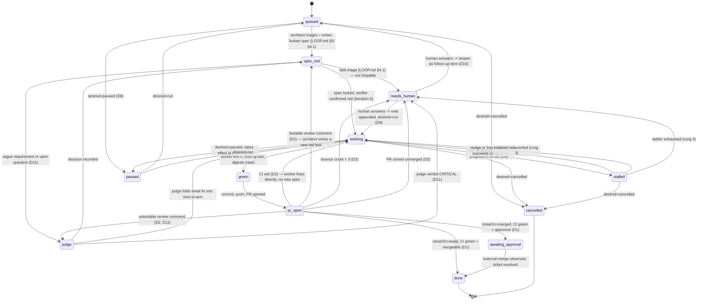

# Loop supervisor — design (2026-09-28)

> Status: Spike 0 ran 2026-09-28/29 (§8); D13 entry agents built in B1–B8;
> **supervisor not built**. Every repository fact below carries a source. Untested
> supervisor behavior is marked `ASSUMED` or `UNKNOWN`.
> Author instructed to ground every claim per `grounding.instructions.md`; this document follows
> that rule throughout.
>
> Open questions resolved 2026-09-28 by judgment (§11); items reserved for the user in §12.

## 1. Problem & evidence

Two independent failures reported by the user, both in the orchestration layer *above*
`scripts/loop.sh` — the inner verifier loop itself is reliable.

**1. Orphan VS Code windows.** `scripts/loop.sh` refuses to open a new window and requires one
already open on `$REPO` (`scripts/loop.sh`, the `window_exists_for_base` check and the
`ABORT — no open window` branch). `LOOP.md` §1.2 states the reason directly: *"a window it
opens itself cannot be closed reliably, and one folder per item left nine orphan windows on
2026-09-27."* `LOOP.md` §1.4.1 additionally documents that no automated close exists at all:
*"`code` has no close flag, System Events cannot reach fullscreen or other-Space windows, and
`kill -TERM` on the renderer raises a confirmation box on a real loop window (2026-09-27)."*
So the current mitigation is "reuse forever, never close" — workable for one human running one
loop by hand, not for a supervisor running many concurrently.

**2. The agentic layer stalls, not the verifier.** `src/store/migrations/0007-loop-runs.sql`
defines `loop_runs.outcome CHECK (outcome IN ('passed','failed'))` with
`CHECK ((outcome IS NULL) = (finished_at IS NULL))` — a row can be left with `outcome IS NULL`
indefinitely if the driver process dies mid-run; nothing currently reaps it
(`0007-loop-runs.sql` schema comment: *"there is no column an agent can set to claim
success"* — true for outcome, but nothing enforces an upper bound on how long `outcome` stays
NULL). `dashboard/pages/loops.ts` (`currentState()`) renders such a row as
`` `${run.latestState} (running)` `` forever. The user's reported figures — 86 rows, 83
passed, 2 failed, 1 null outcome — are `ASSUMED` (a live count of `loop_runs` was not run this
session; see Spike 0 note). Independent of the exact count, the mechanism for the stuck row is
real and traced above: the driver (`scripts/loop.sh`) is a foreground bash loop with no
external watchdog, and `code chat -r` (LOOP.md §1: *"prints nothing useful and its exit code
is meaningless"*, `scripts/loop.sh` header comment) means the driver has no signal at all when
the *dispatch* — not the verifier — is what's stuck: a confirmation prompt, a dropped
subagent response, or a chat waiting on the user all look identical to "still working" from
outside the session.

**Why the inner loop is not the problem.** `LOOP.md` §2 states the design explicitly: *"the
agent never says whether it succeeded... the driver runs the repo's own suite and reads `$?`."*
That verifier-decides-done contract is sound and is being kept unchanged; this document is
about the layer that dispatches turns and notices when a turn never lands.

## 2. Goals / non-goals

**Goals**
- Never leave an item silently stuck: every `working` item either advances, degrades through a
  bounded recovery ladder, or lands in a human-visible `needs_human` state (D6).
- No orphan processes: a supervisor-owned VS Code instance it can start, use, and kill, isolated
  from the user's own windows (D4).
- Keep pushing at any cost short of the denylist: restart, resume, nudge, never block on a human
  unless the recovery ladder is exhausted (D6) or a decision genuinely requires judgment
  (D2 untestable review comments).
- Resumable from any restart: all state in SQLite, `tick()` idempotent (D5).
- Human interface that is desired-state, not command-and-hope: pause/resume/cancel only ever set
  intent; `tick()` reconciles at a safe point (D8).

**Non-goals**
- **Merging.** Never done by the supervisor, ever (D1). `gh pr merge` is added to a
  supervisor-local denylist (§3, D1), separate from and in addition to
  `src/core/policy/denylist.ts`.
- **Approval gates.** Spec approval is off everywhere (D10); the user spot-checks after the
  fact, not before.
- **Replacing `cc`'s executor.** `src/executor/` remains the only code in this repo that
  performs the specific mutations it already performs (Jira resolve, and whatever merge
  support exists — `AGENTS.md`, Layer 4 row: *"`src/sync/`, `src/executor/` | Orchestration.
  The executor is the only writer."*). The supervisor is new, separate code (D3); it does not
  fold into or replace this.
- **Being a chat hook.** Chat hooks (`PreToolUse` etc.) are confirmed unavailable on this
  machine — `DESIGN.md` §13: *"the Copilot org flag `chat_preview_features_enabled=false`
  forces the `ChatHooks` policy off, and `chat.useHooks` is `disallowConfigurationDefault`...
  Five probes fired zero hooks."* The supervisor cannot and does not depend on them; it works
  entirely from outside the session, the same posture `scripts/loop.sh` already takes
  (`LOOP.md` §2, "Why the driver lives outside the session").

## 3. Decisions (D1–D13)

Recorded as decided by the user (session brainstorm, 2026-09-28); rationale added where the
brainstorm didn't spell it out but a repository fact makes it necessary.

**D1 — Supervisor never merges.**
`gh pr merge` is refused by a deny rule in the dedicated profile's terminal rule map (D4), plus supervisor-side commit/push if S7 fails, on top of and
independent from `src/core/policy/denylist.ts`, which does not currently list it (verified:
`src/core/policy/denylist.ts` `FORBIDDEN_ARGUMENTS` = `--no-verify`, `--force`,
`--force-with-lease`, `--admin`, `reset --hard` — no `merge` entry). Rationale: `STACK.md`,
"NOT YET VERIFIED": *"Whether `gh pr merge` actually succeeds — Cannot be verified without
performing a real merge."* An unproven, destructive, hard-to-reverse capability is exactly what
`operationalSafety` guidance reserves for explicit human action. Per-repo `closeOn` is
`merged` or `ready`, configured up front, not inferred:
- `merged` (e.g. grove — external auto-merge on approval per
  [grove/AGENTS.md](../../../../grove/AGENTS.md) Push Safety Policy: *"CI must pass... Merge
  the PR — only then is `master` updated"*): supervisor waits for the external merge event,
  then resolves the ticket. "Awaiting approval" is a normal long-timeout state, not a stall:
  shown on the board immediately; one macOS notification after 24h in `awaiting_approval`
  (held in quiet hours); then one line per day in the morning digest; never becomes
  `needs_human` on its own. `closeOn` is per-repo config; grove's entry is `merged`; any
  repo may be enrolled by adding a config entry (see D12).
- `ready`: CI green + `mergeable` → the supervisor's job for that item is done; the actual
  merge is a human action outside the supervisor's board. Note `STACK.md`, "Known Divergences":
  *"`mergeable` ... Returns `UNKNOWN` on first query because GitHub computes it lazily;
  resolves on re-query. Never emit a stall from `UNKNOWN`."* — the same rule applies here.

**D2 — Bounce-backs after PR opens.**
CI red → worker fixes directly, no architect turn (the failing CI job already *is* the check,
so no new spec is needed — same "verifier already exists and is red" shape `LOOP.md` §4.1
requires before looping at all). Review comment → architect turns it into a red test, then
worker loops on it exactly like a fresh `scripts/loop.sh` run; an untestable review comment
(style, wording) no longer goes straight to `needs_human` — it goes to `loop-judge` (D11),
which decides reply-with-evidence, folding a trivial fix into the next re-arm, or
`needs_human` only if that decision is itself `CRITICAL`. A "testable" classification is
verified mechanically, not taken on the architect's word: the architect must produce a spec
that is red at iteration 0 — `cc loop start` refuses a verifier that already exits 0
(`LOOP.md` §3: *"the driver aborts if it passes"*). If it cannot produce a red spec within one
architect turn, the item is reclassified untestable and goes to `loop-judge`. Max 3
bounce-backs per PR, then `needs_human` regardless of what the 4th comment says — this mirrors
the finite-budget principle already in the design (`LOOP.md` §2, "Budget": *"a model looping
confidently looks exactly like a model making progress"*). PR closed unmerged →
`needs_human` unconditionally.

**D3 — Placement: top-level `supervisor/`, separate from `src/`.**
Run via `npm run supervise`. It is the only code allowed to call `code chat`. Architecture-
guard rule, decided (§11) and applied to `ai-guard.config.json` from a terminal in build step
2 (§10) once `supervisor/` first exists (`AGENTS.md`, "Platform-Managed Files": *"`ai-guard.
config.json` is Copilot-ignored. Modify it from a terminal, not the edit tool."*):

```
{src,dashboard,bin}/** must not import supervisor/**
```

**Widened to include `dashboard/` and `bin/`**: `dashboard/` is not under `src/` — it is its
own top-level directory, grouped only conceptually into "Layer 5" alongside `src/mcp/` and
`bin/` (`AGENTS.md`, Layout table: *"5 | `bin/`, `dashboard/`, `src/config/`, `src/mcp/` |
Entry points."*) — so a `src/**`-only rule would not stop `dashboard/pages/supervisor.ts` from
importing `supervisor/**` directly, and §6 already commits `dashboard/` to reading only
`src/store/` repositories, never `supervisor/**`.

`cc` keeps its own invariant 9 (`DESIGN.md` §19: *"It never invokes a language model... no
phase may introduce one"*) — the supervisor is not a phase of `cc`, it is a separate program
that happens to use `cc`'s store, the same relationship `scripts/loop.sh` already has today.
The supervisor may dispatch a model (`code chat`) but must never treat model *output* as a
decision — only verifier exit codes, CI state, and GitHub/Jira state decide anything, matching
the load-bearing rule already stated for the inner loop (`LOOP.md` §2: *"the agent never says
whether it succeeded"*).

**D4 — Dedicated loop VS Code instance.**
Launch `code --user-data-dir tmp/loop-vscode --new-window <folder>`. Dispatch with
`VSCODE_PORTABLE=tmp/loop-portable code chat -m <agent> "<prompt>"`, with
`tmp/loop-portable/user-data` symlinked to `tmp/loop-vscode`. Do **not** pass
`--user-data-dir` to `chat`: Spike 0 routed that invocation to the main profile (§8 i).
Verify the dedicated Electron root by its exact user-data-dir argument before teardown;
never signal the user's main instance.

Containment, strongest first (proposed profile configuration; S7–S9/S12 remain open):

1. Fail-closed dedicated-profile terminal allowlist:
  `chat.tools.global.autoApprove: false`, `chat.permissions.default: "default"`,
  `chat.tools.terminal.enableAutoApprove: true`, and
  `chat.tools.terminal.autoApprove` as a narrow allow map plus deny regexes **generated**
  from `src/core/policy/denylist.ts` and `gh pr merge`, never hand-written. Cover short
  and alternate forms (`commit -n`, `push -f`, `+ref` refspecs, `-c core.hooksPath`,
  `HUSKY=0`). Override built-in write-capable defaults such as `echo` to `false` and set
  `chat.tools.terminal.blockDetectedFileWrites: "all"`; effectiveness is **UNKNOWN**
  until S8. Deny-over-allow precedence is **UNKNOWN** until S7: S2/S4 had no positive
  allow control. If S7 fails, do not allowlist `git push` or `gh`: supervisor code must
  enforce the denylist and perform commit, push and PR creation.
2. D6 surfaces pending commands, never approves them. No forging consent keys or clicking.
3. Existing repo hooks (`.githooks/pre-commit`, grove's `.husky/pre-push`).
4. Post-hoc audit of every confirmed `toolSpecificData.confirmation.commandLine` in this
  instance's sessions against the denylist, writing matches to `supervisor_events`.
5. Teardown: verify root PID by exact `--user-data-dir` and snapshot descendants;
  TERM, wait 30s, KILL same root if needed, then KILL any snapshotted live descendants.

Drop the PATH shim entirely: the agent terminal did not inherit
`terminal.integrated.env.osx.PATH` (C-quinque 3), and `/usr/bin/git` bypassed a shim
(C-quater control). An untested agent-specific profile cannot fix absolute paths.
Each fresh profile needs **human** Copilot sign-in and acceptance of the terminal-warning
dialog; the supervisor never writes `chat.tools.terminal.autoApprove.warningAccepted`.
MCP is disabled in the dedicated profile pending S9, using a setting key read from the
installed bundle before use. GUI quit-sheet behavior and cold-start portable dispatch
remain `UNKNOWN`; KILL is the fallback. Residual risks are enumerated in §9.

**D5 — Runtime.**
One idempotent `tick()`; all state in SQLite so any restart resumes from the database, not from
in-memory state. Resident process under `launchd` `KeepAlive`, ticking ~30s, writing a
heartbeat row; a second `launchd` job on `StartCalendarInterval` (not `StartInterval` —
`DESIGN.md` §12 gives the reason with a cited man-page quote: *"`StartInterval`... 'If the
system is asleep during the time of the next scheduled interval firing, that interval will be
missed'"*) every 5 minutes restarts the resident process if the heartbeat is stale. Manual
single pass: `npm run supervise -- tick`. Runs 24/7; notifications respect quiet hours by
default (`DESIGN.md` §12: *"Quiet hours 23:00–07:00, implemented structurally via
`StartCalendarInterval`"*) — the user did not object to this default in the brainstorm.

**Grounding note, not previously flagged in the brainstorm:** `STACK.md`, "Scheduling" section
states plainly: *"The hourly `launchd` runner was dropped"* and *"`~/Library/LaunchAgents` —
Empty — nothing installed, nothing to remove"* (verified 2026-08-28). Separately, `DESIGN.md`
§13 records a **one-shot** `launchd` probe that successfully fired `code chat -m ask -r`
headlessly (verified 2026-08-28/2026-09-14). Neither fact demonstrates a **resident**
`KeepAlive` `launchd` job exists or has ever been tried in this environment — D5 is a new kind
of `launchd` usage, not a revival of the removed one, and must be spiked on its own (§8).

**D6 — Stall detection.**
Store `dispatch_at`, `instance_started_at` (`ps -o lstart` on verified root), and a
per-dispatch nonce embedded in the prompt (`[loop <KEY> <nonce>]`). Search the dedicated
instance's `tmp/loop-vscode/User/workspaceStorage/*/chatSessions/*.jsonl` for the nonce.
Fold `kind:0` as root, `kind:1` as set-at-path and `kind:2` as append-at-path (not replace);
`requests` is append-only (B vii). Let R be `requests[-1]` and `stale_s` = now minus file
mtime. Classify in this order:

| Class | Condition | Action |
|---|---|---|
| `DISPATCH_LOST` | No nonce file after 120s from `dispatch_at` (persistence delayed ≥11s in C-quinque 5) | Re-dispatch once, then rung 3 |
| `RELIC` | `mtime < instance_started_at` | Never call it pending: value 4 survives KILL/relaunch (C-ter C6); treat as `DISPATCH_LOST` |
| `PENDING` | `R.modelState.value == 4`, a `toolInvocationSerialized` response has absent `isConfirmed`, `mtime ≥ instance_started_at`, `stale_s ≥ 60` | Split by command below |
| `RUNNING` | `value == 0` and `stale_s < 600` | No action |
| `HUNG` | `value == 0` and `stale_s ≥ 600` | Rung 1: nudge |
| `ENDED` | `value == 1` with `completedAt` | Driver advances or checks verdict; if driver dead D7 reaps |
| `ABNORMAL` | Any other value | Rung 2: fresh session |

For `PENDING`, read `toolSpecificData.confirmation.commandLine`. A denylist or
`gh pr merge` match is `PENDING_DENIED` → `needs_human` immediately with command evidence,
skipping the ladder. Otherwise `PENDING_GAP` skips the nudge (it cannot approve), uses a
fresh session whose briefing names the forbidden command, and on repeat goes to
`needs_human` offering a human settings edit: allow in instance or add to allowlist.
The supervisor never grants approval. Do not use `pendingRequests`, `isComplete` (always
true on serialization), or `isConfirmed.type` (type 4 is not cancellation) as the signal
(B iii, C-ter). Recover other stalls with nudge → fresh session → verified-root teardown
and relaunch (D4) → `needs_human` with session path and verifier tail. Tests/diff/mtime
progress still resets the 10-minute clock; the 34-minute hard ceiling remains.

**N = 10 minutes, decided (§11).** Rationale: `scripts/loop.sh`'s own per-turn budget is
`POLL_LIMIT=72` × 5s = 6 minutes per iteration (`scripts/loop.sh` line 30), so the driver's own
budget fires first on a merely slow turn — the supervisor only needs to catch what the driver
cannot: a dead driver, an unanswered prompt, or a dropped response. There is also a hard
ceiling independent of the three signals: an item in `working` longer than
`MAX_ITER` × `POLL_LIMIT` × 5s + 10 min (= 34 min with the defaults, `MAX_ITER=4` at
`scripts/loop.sh` line 29) with no driver verdict at all is stalled regardless.

**D7 — Housekeeping every tick.**
Finish/abandon `loop_runs` rows whose driver is dead (`outcome IS NULL`, per §1 evidence) —
note this reuses `loop_runs`/`loop_iterations` (`0007-loop-runs.sql`) rather than duplicating
them; see §5 for why the supervisor still needs *new* tables alongside these. Kill loop
instances (D4) with no live item assigned. Prune worktrees whose PR is merged or closed.

**D8 — Human interface: desired-state model.**
Every item has `desired` ∈ {`run`, `paused`, `cancelled`}; every human control only sets this
column. `tick()` reconciles, and a pause takes effect only at a safe point — never mid-commit.
Global `supervise halt`. Full table in §6.

**D9 — Intake, pluggable sources.**
(a) manual — chat `/loop <key> <brief>` (enqueue only; the architect and worker still run
*inside* the loop instance, not in the user's own chat), CLI
`npm run supervise -- add <key> --repo=<r> --brief="…"`, dashboard form. (b) plan files —
unchecked boxes in a configured file (e.g. `grove/HOMEWORK_PROGRESS.md`, confirmed to exist:
[grove/HOMEWORK_PROGRESS.md](../../../../grove/HOMEWORK_PROGRESS.md)), queued in file order.
(c) Jira tickets assigned to the user carrying a `loop` label — label is `loop`, decided
(§11); Jira labels are created on first use, so no admin step is needed. Dedupe by key across
all three sources.

**D10 — No approval gates.**
Spec approval off everywhere; contrasts deliberately with the manual loop's human checkpoint
at green (`LOOP.md` §6: *"the diff gets read once, by a person, before it leaves the
machine"*) — see §9 for why removing that checkpoint is a named risk, not a free change.
"Reopen with correction" creates a follow-up item carrying the user's note, rather than
mutating the closed one. **Accepted as decided (§11).** Mitigation: the phase-4 referee is
mandatory in the supervisor and runs on `loop-judge` (the `oracle` tier) — it is reject-only, so its
`accept` is necessary but never sufficient; the verifier's exit code and CI still decide.

**D11 — Model routing & escalation.**
Default driver/architect = the registry's `architect` tier (`registry/model-tiers.json`),
currently GPT-6 Sol, chosen in the 2026-09-28 coding-benchmark re-tier; worker = the
`worker` tier (`loop-worker`, currently GPT-5.6 Luna); judgment = the `oracle` tier
(`loop-judge`, currently Claude Opus 5.5). Model routing itself now lives in
`registry/model-tiers.json`
(worker/dispatcher/architect/oracle tiers, `cc models`/`cc models pick`/`cc models apply`,
escalation on failure/doubt capped at `oracle` — see `LOOP.md` §6a), not hardcoded here or in
agent frontmatter. Any question that would otherwise go to the user goes to
`loop-judge` first; only a `CRITICAL` verdict creates `needs_human`. `CRITICAL` means the
decision: (1) enrolls a repo not already enrolled for loops, or pushes to / comments on /
changes someone else's PR, branch, or ticket; (2) involves credentials, money, production, or
deleting data; (3) changes a recorded design decision (D1–D13 here), an `AGENTS.md` invariant,
the denylist (`src/core/policy/denylist.ts`), or `ai-guard.config.json`; (4) is irreversible
outside this machine beyond the normal loop flow. Every judgment is appended to
`tmp/<KEY>-decisions.md` and recorded as a `supervisor_events` row (§5) so the user can
spot-check it after the fact. Only top-level `loop-architect` and `loop-analyst` are
human/supervisor entry agents. `loop-judge` is a leaf consult, user-invocable only to allow
headless supervisor dispatch; `loop-worker*` are headless leaves dispatched by the driver.
The architect directly dispatches the judge when top-level. When dispatched as a
subagent it returns `CONSULT_NEEDED: tmp/<KEY>-consult.md`; its caller runs the judge and
re-dispatches the architect (`loop-architect.agent.md`, Escalation; B vi found no nested
dispatch tool). Supervisor architect sessions run top-level via `code chat -m loop-architect`;
headless top-level subagent access is `ASSUMED` (S10). If unavailable, supervisor dispatches
`code chat -m loop-judge "consult tmp/<KEY>-consult.md"`, waits for the judgment artifact,
and re-dispatches the architect. Humans select the architect in the picker, not as a
subagent, unless they accept these round trips. Routing priorities and price bands live
in `registry/model-tiers.json`.

**D12 — Repo- and task-agnostic.**
Nothing in supervisor code may name a specific repo, branch, test runner, or task type.
Everything repo-specific lives in one per-repo config entry: path, base branch, verify
command, `closeOn` (`merged`/`ready`), and a plan-file path for D9b if any — the same shape
the verifier already uses: `scripts/loop.sh` parameterises entirely via `REPO` (line 25),
`SPEC` (line 27), and `verify()` (line 35), and the supervisor's per-repo config is that same
parameterisation lifted one layer up, not a new mechanism. Enrolling a repo means the user
adding an entry; agents never self-enroll — this is exactly why `loop-judge` treats
enrollment as `CRITICAL` (D11). A repo with no config entry is refused at intake with a clear
message, never guessed at. `grove` is the first entry, not a special case baked into the code.
Decided by the user, 2026-09-28 (§12).

**D13 — Human entry: two agents, no router.**
A router adds a turn to every job. The entry agents' task-fit preflight STOP and handoffs
correct wrong picks; handoff parsing is verified from installed source (B viii), a live
click is not. Every STOP also names the replacement in text.

| Task | Entry agent | Tier → recommended model (`cc models pick <tier>`) |
|---|---|---|
| Implementation, reproducible bug (red test first), checkable doc change, own-PR feedback and resumes | `loop-architect` | architect → GPT-6 Sol |
| Planning, others' PR review (draft only), investigation without a repro | `loop-analyst` | architect → GPT-6 Sol |
| Research, questions, prose docs | `loop-analyst` | dispatcher → Gemini 3.8 Flash |
| Referee / consult | `loop-judge` (leaf, not a human pick) | oracle → Claude Opus 5.5 |
| Grinding | `loop-worker*` (driver only) | worker → GPT-5.6 Luna |

`loop-analyst` offers “Loop this item” → architect; architect offers “Not loopable —
investigate or plan instead” → analyst. Preflight order: (1) task fit, STOP `WRONG AGENT:
this is <type>. Pick <agent> with <model>.`; judge requires a consult path and worker
requires driver's `Current verifier output:` line; (2) selected-model cost via
`npm run --silent cc -- models self --session-log=<VSCODE_TARGET_SESSION_LOG> --tier=<tier>`
and `cc models pick <tier>`, warn once but never STOP for price or `copilot/auto`/unknown;
only *selected*, never backend-served model is known (B vii); (3) explicit repo path or
name resolving to `~/dev/<name>`, `git -C <repo> rev-parse --abbrev-ref HEAD` or STOP
and ask for repo; outside read via `list_dir` needs no grant (B ix), terminal may require
unsandboxed approval, edits require a workspace folder or loop window, others' review
clones go under `bot/tmp/rv<pr>`; only Clover remotes get a WS ticket with Epic
`WS-5345`, while other repos use `<REPO>-<slug>` and no Jira ticket; (4) resume using
`tmp/<KEY>*`, `cc loop status`, branches and `gh pr list --head <branch> --state all`:
no artifacts → phase 0; consult without judgment → judge; spec without driver → phase 2;
unclosed dead run → note then start new run (D7 reap not built); passed/no PR → phase 4;
PR open → phase 6; PR merged/ticket open → resolve. Analyst resumes from its incrementally
written `tmp/<KEY>-report.md`; actual artifacts outrank prose.

Variant names use tier rank: worker `.t2/.t3/.t4`, architect `.t4` (oracle).
Headless variants stay visible because B viii found `user-invocable:false` prevents
`code chat -m` lookup; their STOP preflight guards accidental picker use. Humans pick
the base agent then choose any model (picker override holds until agent re-selection).
The registry's `interactive` list contains analyst without variants; probes are unmanaged.
The entry agents and `models self` were built at HEAD in B1–B8; this does **not** mean
the supervisor has been built.

## 4. Architecture

Components, by directory (new unless noted):

| Component | Path | Role |
|---|---|---|
| Supervisor core | `supervisor/tick.ts` (proposed) | The one idempotent entry point; everything else is called from here |
| Item sources | `supervisor/sources/{manual,plan-file,jira}.ts` (proposed) | D9 pluggable intake, deduped by key |
| Recovery ladder | `supervisor/stall.ts` (proposed) | D6 detection + the four-rung ladder |
| Bounce-back handler | `supervisor/pr-review.ts` (proposed) | D2 |
| Loop-instance manager | `supervisor/vscode-instance.ts` (proposed) | D4: start/kill the dedicated Electron process |
| Dedicated profile | `supervisor/profile/settings.template.json` (proposed) | D4 narrow terminal rules generated from compiled denylist; S7–S9/S12 gates apply |
| CLI | `supervisor/cli.ts` (proposed), `npm run supervise` | D5, D8 |
| State | `src/store/migrations/00XX-supervisor.sql` (proposed) | §5 — lives in `cc`'s existing store, per D3 |
| Dashboard board | `dashboard/pages/supervisor.ts` (proposed) | D8 monitor, reading `src/store/` only (never `supervisor/**` — see D3 gap above) |
| MCP extension | `src/mcp/` (existing dir; new read-only tool) | D8, extend `cc_status` per `.github/instructions/central-command.instructions.md` |

State diagram for one item (D8 board columns, plus the edges D2/D6 add):



`needs_human` is drawn as reachable from every intermediate state, not just `stalled` and
`pr_open`, matching D6/D2's own wording ("Each rung counted and budgeted", "Max 3
bounce-backs... then `needs_human`").

## 5. Data model

Proposed new tables, added by a new migration (`src/store/migrations/00XX-supervisor.sql`,
following the numbering convention already visible in `src/store/migrations/0007-loop-runs.sql`):

- **`supervisor_items`** — one row per unit of work on the board: `key` (dedupe target, D9),
  `source` (`manual`/`plan-file`/`jira`), `repo`, `state` (the diagram above), `desired`
  (`run`/`paused`/`cancelled`, D8), `bounce_count` (D2, `CHECK (bounce_count <= 3)`),
  `close_on` (`merged`/`ready`, D1, set at creation from per-repo config, never inferred),
  `loop_run_id` (nullable FK into the *existing* `loop_runs.id`), timestamps.
- **`supervisor_events`** — append-only, one row per state transition or ladder rung, carrying
  the evidence that justified it (session file path, verifier tail, CI check name). This is
  the audit trail for §8's "needs_human with evidence" requirement — without it, a
  `needs_human` row is an assertion, not a finding, which `pr-review-verification.instructions.md`
  (a different but related instruction in this workspace) treats as worthless.
- **`supervisor_heartbeat`** — single row (or one per resident process), `last_tick_at`, read
  by the `StartCalendarInterval` watchdog (D5) to decide whether to restart.

**Why new tables, not a query over `actions` or over `loop_runs`.** `DESIGN.md` §8 states the
precedent directly and its reasoning generalizes: *"An earlier draft had a separate
`queue.jsonl`. That was a mistake: it duplicates rows that already exist in the audit record...
Instead, `actions` carries `resolution`, `resolved_at`, `resolved_by`, and the approval inbox is
[a] `SELECT`."* That precedent applies when the rows in question **already exist** as
`actions` — a supervisor item is not an action (it is not a single proposed mutation under
`cc`'s policy engine; `DESIGN.md` §19 invariant 2, "default is queue", governs `actions`
specifically). The closer precedent is `loop_runs` itself, whose own migration comment already
drew this boundary once: `0007-loop-runs.sql`: *"These are NOT `actions`. An action is a
mutation this system performs under policy... A loop run is the opposite: an observation of
work a human started, recorded after the fact... the executor never reads it."* A
`supervisor_item` is one level further out again: `loop_runs` records one verifier-driven
attempt; `supervisor_items` records the **lifecycle around zero or more** such attempts (spec
writing, PR review bounce-backs, human answers) that `loop_runs` was never shaped to hold — a
single item may accumulate several `loop_run_id`s (fresh session, D6 rung 2) or none yet
(`queued`, `spec_red`). Folding that lifecycle into `loop_runs` would mean adding columns
(`bounce_count`, `desired`, `source`) to a table whose own comment says it exists to be an
*observation*, not a *control surface* — which is exactly the queue/table distinction
`DESIGN.md` §8 warns about, just one layer up.

## 6. Human interface

| Action | Mechanism | Notes |
|---|---|---|
| Create | Chat `/loop <key> <brief>` | Enqueues only; architect + worker still run inside the loop instance (D9a) |
| Create | CLI `npm run supervise -- add <key> --repo=<r> --brief="…"` | D9a |
| Create | Dashboard form | D9a |
| Create | Plan-file unchecked boxes | Auto-discovered, queued in file order (D9b) |
| Create | Jira `loop`-labelled tickets assigned to the user | Auto-discovered (D9c, label is `loop`, decided) |
| Start | Automatic | One queued item starts per repo at a time, by priority (D8) |
| Control | `supervise pause\|resume\|cancel\|retry\|bump <key>` + matching dashboard buttons | Sets `desired` only; `tick()` reconciles (D8) |
| Unblock | Dashboard "Needs you" inbox, evidence attached | Answer (note appended to next briefing, `desired=run`) or Drop (D6, D8, §5 `supervisor_events`) |
| Monitor | Dashboard `/supervisor` board | Columns match the state diagram (§4); existing `/loops` page stays read-only exactly as today (`dashboard/pages/loops.ts` comment: *"there is no button here and there must never be one... a 'run loop' control would be exactly that"* [invoking a model] — the new board's buttons set `desired`, they do not invoke a model, so this does not reopen that constraint, but the distinction should be stated in code, not just here) |
| Monitor | Per-item timeline | Links `loop_runs`, PR, chat session (§5 `supervisor_events`) |
| Alert | macOS notification on `needs_human` | Held during quiet hours (D5); morning digest line |
| Monitor | `cc_status` MCP tool | Extended, read-only, per `.github/instructions/central-command.instructions.md` ("Use it instead of guessing... Report the mirror's age") |

## 7. Invariant changes needed in `AGENTS.md` — wording proposals only (not applied)

`AGENTS.md` is not edited by this document, per instructions. Proposed wording, for the user to
apply or reject:

1. Under "Layout", add a Layer 6 row: `supervisor/` | Orchestrates loop items end-to-end;
   the only code allowed to call `code chat` outside a human's own session; imports from
   `src/store/` only, never the reverse.
2. Extend the existing rule *"`src/mcp/` never imports `src/executor/`"* (`AGENTS.md`, Layout
   table footnote / `DESIGN.md` §19 invariant 12) with a parallel one:
   *"`src/**` and `dashboard/**` must not import `supervisor/**`. An agent editing the mirror
   or the dashboard cannot reach into loop orchestration, as a property of the code."*
   (Widened from the D3 wording to also cover `dashboard/`, per the gap noted in §3.)
3. `DESIGN.md` §19 invariant 9 currently reads *"It never invokes a language model. There is no
   headless path to one (§13)"* — but §13 itself was already corrected once (*"This section
   previously asserted... The premise was wrong"*) to say a headless path **does** exist via
   `code chat`. The invariant's *conclusion* (cc itself never invokes a model) should stay, but
   its stated *reason* is now false and should read: *"It never invokes a language model. A
   headless path exists (§13) but is deliberately not used here; the supervisor (a separate
   program, see supervisor/) is where headless dispatch lives, and it never treats model output
   as a decision — only verifier exit codes, CI, and Jira/GitHub state do."* Leaving the old
   wording in place invites a future reader to re-derive "no headless path exists" and build on
   that false premise a second time.

**Status (§11): proposal 3 is APPLIED** — `DESIGN.md` §19 invariant 9 was updated in this
commit to the wording above. **Proposals 1 and 2 are decided** but intentionally not applied
yet: they will be added to `AGENTS.md` in the build step that first creates `supervisor/`
(§10, build order), so `AGENTS.md` never describes code that does not exist.

## 8. Spike 0 — results (2026-09-28/29)

The excerpts below are verbatim **command and key output** from the Spike 0 reports;
their original falsifiers and full probe records are in `tmp/SPIKE0-{A,B,C}-report.md`
(disposable). Verdicts and the decisive proof live **here**. `VERIFIED` describes the
observed result, including failed hypotheses; it does not mean the original claim passed.

| # | Claim / falsifier | Result (verbatim evidence excerpt and report section) |
|---|---|---|
| i | `--user-data-dir` routes `chat`; portable symlink isolates routing | **VERIFIED FAIL** direct flag: `Warning: 'user-data-dir' is not in the list of known options for subcommand 'chat'`; `AFTER DED 2 HITS []` (A probe 3). **VERIFIED PASS** portable routing after sign-in: `VSCODE_PORTABLE=/Users/jay.quach/dev/bot/tmp/spike0-portable '/Applications/Visual Studio Code.app/Contents/Resources/app/bin/code' chat -m ask 'SPIKE0-CTER-SIGNIN-9c14: Reply with ROUTED-9c14 only.'` → `AFTER DED COUNT 5`, `AFTER MAIN COUNT 625`, `REQUEST 1 modelId copilot/auto agent github.copilot.default responseKinds ['mcpServersStarting', None] responseTextLengths [11] modelState {'value': 1, 'completedAt': 1790660450439}` (C-bis route 2, C-ter 0). Model shown is selected, not proof of backend-served model. |
| ii | Per-profile auto-approval without editing main profile | **VERIFIED** after human terminal-warning consent: `touch /Users/jay.quach/dev/bot/tmp/spike0-c5.txt` → `TARGET True`, `MODE {'modeId': 'agent', 'permissionLevel': 'default'}`, `TOOLS [('run_in_terminal', {'type': 1}, {'commandLine': 'touch /Users/jay.quach/dev/bot/tmp/spike0-c5.txt'})]` (C-quinque 2); `MAIN_SHA_AFTER 329b7b46faccfc5b89e57f86c6978878629d2e99e6475edb440aa5f326dc6b9c MAIN_SHA_UNCHANGED True` (C-quater cleanup). Global opt-in remains **UNKNOWN**: `CONSENT [('chat.tools.terminal.autoApprove.warningAccepted', 'true')]` and no global key (C-quinque 1). No main-profile control command was dispatched. |
| iii | Detect pending confirmation uniquely | **VERIFIED** live waiting: `touch /Users/jay.quach/dev/bot/tmp/spike0-c2.txt` → `STATE {'value': 4} WAIT 1790660482927`; `TOOL_META {'kind': 'toolInvocationSerialized', 'isComplete': True, 'toolCallId': 'toolu_01GS61p1tBAfzQfcFw6SLD34', 'toolId': 'run_in_terminal'}`; `toolSpecificData.confirmation {'commandLine': 'touch /Users/jay.quach/dev/bot/tmp/spike0-c2.txt'}` (C-ter C2 and source follow-up). **VERIFIED relic caveat** after KILL/relaunch: `C2_POST_RELAUNCH {'value': 4} [(True, None, True)]` (C-ter C6). File age and instance-start check required; `pendingRequests`/`isComplete` do not discriminate. |
| iv | TERM cleanly tears down dedicated live work without touching main | **VERIFIED** for executing `sleep`: `ps -p 57571,1306,38917 -o pid,ppid,command` → dedicated root and `sleep 600` child; `SIGNAL_SENT SIGTERM 57571`; at 19.3s main 1306 remained, dedicated root and sleep were absent (C-quinque 4). **VERIFIED** TERM insufficient with outstanding request: `SIGNAL_SENT SIGTERM 35309` → `PIDS_AFTER 1306 [main Code]; 35309 [dedicated Code]`; then `DEDICATED_ONLY_SIGKILL 35309` (C-ter C5/C6). GUI quit sheet is **UNKNOWN**. |
| v | PATH shim or terminal rule map prevents unauthorized execution | **VERIFIED FAIL** PATH: `command -v git -> /usr/bin/git (exit 0)` and `gh pr merge 999999 -R kod88vn/grove -> GraphQL: Could not resolve to a PullRequest with the number of 999999. (repository.pullRequest) (exit 1)` (C-quinque 3); `/usr/bin/git --version` → `ABSOLUTE_BYPASSED_SHIM True` (C-quater control). **VERIFIED** one unlisted non-default command pends: `command -v gh` → `modelState {'value': 4}`, `run_in_terminal isConfirmed None`, `terminalCommandOutput None` (C-sexies S5). **VERIFIED** S3 unlisted `echo spike0-s3 > /Users/jay.quach/dev/bot/tmp/spike0-s3.txt` ran: `state {'value': 1, 'completedAt': 1790662332400}`, `confirmed {'type': 1}`, target exists (C-sexies S3). `echo` is actually built-in approved by default: installed `workbench.desktop.main.js` grep returned `default:{cd:!0,echo:!0,ls:!0,dir:!0,pwd:!0,cat:!0,head:!0,tail:!0,findstr:!0,wc:!0,tr:!0,cut:!0,cmp:!0` (dispatcher source grep). **UNKNOWN** deny-over-allow precedence: S2 `gh pr merge 999999 -R kod88vn/grove` and S4 `/usr/bin/git --no-verify status` were pending (`state {'value': 4}`, `confirmed None`; C-sexies S2/S4), but neither matched an allow rule. |
| vi | Nested dispatched architect can dispatch judge | **VERIFIED** no nested dispatch exposed in B's actual tool list: `functions.{apply_patch,create_file,read_file,run_in_terminal,grep_search,file_search,semantic_search,...}`, `multi_tool_use.parallel`; `no runSubagent, dispatch, or subagent-dispatch function exposed` (B vi). Top-level architect dispatch is supported by its agent contract; headless top-level capability remains **ASSUMED** (S10). |
| vii | Agent can discover its own model | **VERIFIED** request-selected only: `kind:2,k:['requests'],v:[{requestId,modelId,...}]` → all 9 appended request records `modelId: 'copilot/claude-opus-5.5'` (B vii). `main.jsonl` contains no resolved-model event; backend-served model is **UNKNOWN**. |
| viii | Model pins, picker overrides, CLI visibility and handoffs | **VERIFIED from installed source** (B viii): `refreshCustomPromptModes()` → `if(!n.visibility.userInvocable||!n.enabled)continue;`; `findModeByName(e)` searches custom modes; `_switchToAgentByName(e.agent)` handles handoff; mode observer `It&&this.switchModelByQualifiedName(It)` applies pin when agent changes. Hence hidden headless variants cannot be selected with `code chat -m`; a human model override after agent choice persists until next agent change. Live handoff click is **UNKNOWN**. |
| ix | Every outside-folder read requires a grant | **VERIFIED FAIL for `list_dir` only**: `list_dir /Users/jay.quach/dev` → `bot/`, `grove/`, `web-storefront-engine/` without confirmation (B ix). Outside terminal/edit permissions remain **UNKNOWN** per operation; add workspace folder, approve when prompted, or clone into bot/tmp. |

Additional `ASSUMED` facts: reported 86/83/2/1 `loop_runs` figures (§1);
resident-process `launchd` `KeepAlive` behavior (D5); B's current tool list is not
proof all top-level contexts lack a dispatch tool. No `VERIFIED` verdict here claims a
working supervisor or a universal security boundary.

### Spike 0b — follow-up gates (not run)

| Probe | Claim to falsify | Falsifier / control |
|---|---|---|
| S7 | Deny overrides a matching allow | Allow `gh` and `git commit`, deny `gh pr merge` and `--no-verify`; show harmless `gh`/`git commit` positive control executes and forbidden variants pend. Without positive control, S2/S4 prove nothing about precedence. |
| S8 | Built-in write defaults can be overridden | Set `echo:false` and `chat.tools.terminal.blockDetectedFileWrites:"all"`; a new agent-run `echo … > scratch` must pend and leave target absent, while allowed read succeeds. |
| S9 | Non-terminal MCP cannot merge unattended | In dedicated profile trigger an MCP tool call and observe pending, or disable MCP with an installed-source-verified setting and prove no MCP merge tool is offered. |
| S10 | Headless top-level architect can consult judge | `code chat -m loop-architect` with a consult dispatch; inspect resulting judge artifact and selected request model; absence triggers D11 fallback. |
| S11 | Portable cold start routes correctly | With no dedicated process running, invoke portable `code chat` and check nonce appears only in dedicated store; failure requires explicit launch first. |
| S12 | Short forms cannot evade denies | Positive controls plus `commit -n`, `push -f`, `-c core.hooksPath`, `+ref`, `HUSKY=0` must pend (never send a real destructive command). |

## 9. Risks

| Risk | Note |
|---|---|
| D4 residual risk (1): allowlisted test code | The allowlist stops drift and habit, not an adversary. Any allowlisted test runner (`npx jest`, `yarn test`, `node --test`) executes code the worker just wrote, and that code can spawn `gh pr merge` through `child_process`. Same step-gate limit stated in `AGENTS.md`. |
| D4 residual risk (2): non-terminal tools | Terminal rules do not govern edit or MCP tools. Grove's `.vscode/mcp.json` registers a GitHub MCP server which may expose merge; whether MCP pends is **UNKNOWN** (S9). Disable MCP in the dedicated profile until proven, after checking the installed setting key. |
| D4 residual risk (3): sandbox off | `$JIRA_DC_TOKEN`, SSH keys and `gh` token remain reachable, as already per-command today (`DESIGN.md` §13). |
| D4 residual risk (4): credentials | Only a merge-incapable token actually prevents merging. This is a user-owned credentials change, not required for D4. |
| D4 residual risk (5): GUI quit sheet | **UNKNOWN**; KILL on verified root is the fallback. |
| D4 residual risk (6): cold start | `VSCODE_PORTABLE` with no running instance is **UNKNOWN** (S11). |
| D4 residual risk (7): first use | Each new profile needs human Copilot sign-in and terminal-warning acceptance. Supervisor must not forge consent storage. |
| S7 gate | Deny rules overriding broader allow rules is **UNKNOWN**: S2/S4 would have pended even without the denials. If falsified, no allowlisted `gh`/`git push`: move commit/push/PR-create to supervisor code. |
| Removing the human diff-review checkpoint at green | `LOOP.md` §6 calls this out as deliberate: *"those are the steps where a mistake is expensive and hard to reverse, and they are the steps a human is best placed to sanity-check."* D10 removes it in favor of after-the-fact spot-checks; consistent with the user's stated tradeoff ("cheaper to fix later than to sit and wait") but should be named as a conscious reversal, not a silent one |
| Guard wording gap (`src/**` vs `dashboard/**`) | Resolved by D3 widening (§11) — the rule now covers `dashboard/` and `bin/` |
| `launchd` `KeepAlive` semantics unverified in this environment | §5/§8 — only one-shot firing and `StartCalendarInterval` catch-up semantics have been read/verified (`DESIGN.md` §12, `STACK.md`); a resident daemon is a different `launchd` feature |
| Autonomous commit/push without the LOOP.md checkpoint could push something a bounce-back can't detect (e.g. tracked build output going stale) | `LOOP.md` §6 names this exact failure class: *"Regenerate tracked build output... or the PR is inconsistent with its own source."* A CI-red bounce may not catch a build artifact drift if CI doesn't rebuild it. Mitigated by the mandatory Opus referee (D10, D11), whose phase-4 review reads the shipped artifact, not just CI. |
| Bounce-back triage (D2, "testable" vs "not") is itself a model judgment | Verified mechanically by red-at-iteration-0 (D2): the architect's classification is checked by whether it can produce a spec that fails at iteration 0, not taken on its own word |
| `closeOn=ready` "done" does not mean merged | Must be worded carefully everywhere in UI/notifications so it is never read as "shipped" — conflating the two was exactly the failure `AGENTS.md` "Finish the loop" section already worries about: *"a PR merges, everyone moves on, and the ticket stays Open"* |

## 10. Build order

1. **Spike 0** (§8) — ran 2026-09-28/29; results and D4/D6/D11 decisions above.
1a. **B1–B8 entry-agent slice** — built at HEAD: `models self`, rank-based variants,
  registry interactive list, `loop-analyst`, entry preflights, prompt and meta-spec;
  this document and the guides record the shipped behavior.
1b. **Spike 0b S7–S12** (§8) — falsify containment/routing assumptions; **required before
  step 3**. S7 failure switches commit/push/PR creation to supervisor code (D4).
2. Data model (§5) — migration, no behavior yet; lets `supervisor_events` start recording
   manually-triggered test runs during spike work.
3. `tick()` skeleton + D7 housekeeping only (reap dead `loop_runs`, kill orphaned instances) —
   the smallest slice that is already a net improvement over today with no new dispatch logic.
4. D9a manual intake + `queued → spec_red → working → green` for a single item, no PR/bounce
   logic yet — reuses `scripts/loop.sh`'s own dispatch shape almost unchanged.
5. D6 stall ladder — only once step 4 has produced a real stalled run to test against.
6. D2 PR bounce-backs + D1 `closeOn` handling.
7. D8 dashboard board + human interface; D9b/D9c additional intake sources; notifications.

## 11. Decisions taken by judgment (2026-09-28)

| Question | Decision | Why |
|---|---|---|
| D3 guard wording gap | Widen to `{src,dashboard,bin}/** must not import supervisor/**` | `dashboard/` is the path most likely to read supervisor state for the board; leaving it out makes the boundary a convention, not a property of the code (`DESIGN.md` §19 invariant 12) |
| §7 AGENTS.md proposals | Proposal 3 applied now (`DESIGN.md`); proposals 1–2 decided, applied when `supervisor/` first exists | `AGENTS.md` should never describe code that does not exist yet |
| D6 stall window N | 10 minutes, plus a hard ceiling of `MAX_ITER × POLL_LIMIT × 5s + 10min` | The driver's own budget (`scripts/loop.sh` line 30, 6 min/iteration) fires first on a merely slow turn; the supervisor only needs to catch what the driver cannot |
| D1 awaiting-approval notice timing | Board immediately; one notification at 24h; daily digest line after that | Never a stall, but silence for days reads as one without some signal |
| D9c Jira label name | `loop` | Labels are created on first use in this Jira instance; no admin step required |
| D1 per-repo `closeOn` | grove = `merged`, the first configured entry | Only grove has an external auto-merge policy documented (`grove/AGENTS.md`); other repos are enrolled by adding a config entry (D12) |
| Scope of repos/tasks | any repo, any task (user, 2026-09-28) | D12 |
| D10 approval-gate removal | Accepted, with a mandatory mitigation | The phase-4 `oracle`-tier referee (D11) is reject-only and mandatory in the supervisor, so *some* judgment gate survives even with human pre-approval off |
| D2 bounce-back triage verification | Verified mechanically, not by model say-so | "Testable" means the architect can produce a spec that is red at iteration 0 (`cc loop start` refuses an already-green verifier); failure to do so within one turn reclassifies the item as untestable |
| Spike 0 go-ahead | Approved to run | All five original items plus new item vi are falsifiable by a command; none require a design change to attempt |
| Model routing | Registry `architect` tier for architect/driver (currently GPT-6 Sol); `oracle` tier for `loop-judge` (currently Claude Opus 5.5); `worker` tier for `loop-worker` (currently GPT-5.6 Luna) | Updated by the 2026-09-28 coding-benchmark re-tier; `registry/model-tiers.json` is the source of truth for priorities and price bands |
| D4 routing / containment | Portable-symlink dispatch to dedicated profile, narrow allowlist; no PATH shim; S7/S8/S9/S12 pending | A/C routed the prompt and disproved the shim; C-sexies S2/S4 cannot establish deny-over-allow |
| D6 pending | `value=4` + unconfirmed serialized tool + nonce + instance-age/mtime guard; split denied vs gap | C-ter observed a pending tool and a stale value-4 relic after relaunch |
| D11 consult | Architect/analyst top-level; judge subagent leaf; worker headless; `CONSULT_NEEDED` when nesting unavailable | B vi had no dispatch tool in nested context; S10 remains open |
| D13 entry | Two entry agents with task-fit STOP, model-cost warning, repo/resume preflight | B vii/viii/ix, B1–B8 at HEAD; supervisor intake remains unbuilt |
| Variant suffix | Tier rank (`loop-worker.t2/.t3/.t4`, `loop-architect.t4`); variants stay visible for CLI lookup | B viii installed custom-mode lookup excludes hidden agents; generated files at HEAD |

## 12. Reserved for the user

Everything above is decided by judgment and does not wait on the user:

(a) Answered 2026-09-28: the design is repo- and task-agnostic (D12).

(b) Spike 0 ran with the user's go-ahead (2026-09-28/29); results in §8. On hold lifted.

(c) Optional, user-only: a merge-incapable token for the dedicated instance (residual risk 4).

Nothing else in this document is reserved.

## Committing

Command sequence, cwd `/Users/jay.quach/dev/bot`, branch `feature/central-command`, no
remote — this stays local. Executed under `requestUnsandboxedExecution=true` because the
pre-commit hook needs `npx` (`~/.nvm/.../bin`, outside the sandbox root).
