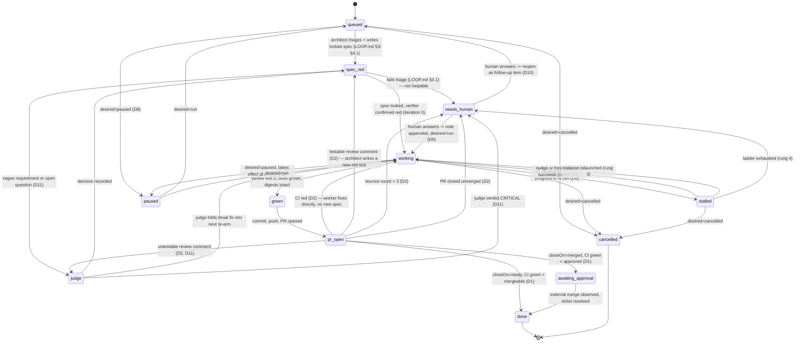

# Loop supervisor — design (2026-09-28)

> Status: design only, nothing built. Every repository fact below carries a source. Anything
> not read from this repo or not yet run is marked `ASSUMED` and repeated in §8 (Spike 0).
> Author instructed to ground every claim per `grounding.instructions.md`; this document follows
> that rule throughout.
>
> Open questions resolved 2026-09-28 by judgment (§11); items reserved for the user in §12.

## 1. Problem & evidence

Two independent failures reported by the user, both in the orchestration layer *above*
`scripts/loop.sh` — the inner verifier loop itself is reliable.

**1. Orphan VS Code windows.** `scripts/loop.sh` refuses to open a new window and requires one
already open on `$REPO` (`scripts/loop.sh`, the `window_exists_for_base` check and the
`ABORT — no open window` branch). `LOOP.md` §1.2 states the reason directly: *"a window it
opens itself cannot be closed reliably, and one folder per item left nine orphan windows on
2026-09-27."* `LOOP.md` §1.4.1 additionally documents that no automated close exists at all:
*"`code` has no close flag, System Events cannot reach fullscreen or other-Space windows, and
`kill -TERM` on the renderer raises a confirmation box on a real loop window (2026-09-27)."*
So the current mitigation is "reuse forever, never close" — workable for one human running one
loop by hand, not for a supervisor running many concurrently.

**2. The agentic layer stalls, not the verifier.** `src/store/migrations/0007-loop-runs.sql`
defines `loop_runs.outcome CHECK (outcome IN ('passed','failed'))` with
`CHECK ((outcome IS NULL) = (finished_at IS NULL))` — a row can be left with `outcome IS NULL`
indefinitely if the driver process dies mid-run; nothing currently reaps it
(`0007-loop-runs.sql` schema comment: *"there is no column an agent can set to claim
success"* — true for outcome, but nothing enforces an upper bound on how long `outcome` stays
NULL). `dashboard/pages/loops.ts` (`currentState()`) renders such a row as
`` `${run.latestState} (running)` `` forever. The user's reported figures — 86 rows, 83
passed, 2 failed, 1 null outcome — are `ASSUMED` (a live count of `loop_runs` was not run this
session; see Spike 0 note). Independent of the exact count, the mechanism for the stuck row is
real and traced above: the driver (`scripts/loop.sh`) is a foreground bash loop with no
external watchdog, and `code chat -r` (LOOP.md §1: *"prints nothing useful and its exit code
is meaningless"*, `scripts/loop.sh` header comment) means the driver has no signal at all when
the *dispatch* — not the verifier — is what's stuck: a confirmation prompt, a dropped
subagent response, or a chat waiting on the user all look identical to "still working" from
outside the session.

**Why the inner loop is not the problem.** `LOOP.md` §2 states the design explicitly: *"the
agent never says whether it succeeded... the driver runs the repo's own suite and reads `$?`."*
That verifier-decides-done contract is sound and is being kept unchanged; this document is
about the layer that dispatches turns and notices when a turn never lands.

## 2. Goals / non-goals

**Goals**
- Never leave an item silently stuck: every `working` item either advances, degrades through a
  bounded recovery ladder, or lands in a human-visible `needs_human` state (D6).
- No orphan processes: a supervisor-owned VS Code instance it can start, use, and kill, isolated
  from the user's own windows (D4).
- Keep pushing at any cost short of the denylist: restart, resume, nudge, never block on a human
  unless the recovery ladder is exhausted (D6) or a decision genuinely requires judgment
  (D2 untestable review comments).
- Resumable from any restart: all state in SQLite, `tick()` idempotent (D5).
- Human interface that is desired-state, not command-and-hope: pause/resume/cancel only ever set
  intent; `tick()` reconciles at a safe point (D8).

**Non-goals**
- **Merging.** Never done by the supervisor, ever (D1). `gh pr merge` is added to a
  supervisor-local denylist (§3, D1), separate from and in addition to
  `src/core/policy/denylist.ts`.
- **Approval gates.** Spec approval is off everywhere (D10); the user spot-checks after the
  fact, not before.
- **Replacing `cc`'s executor.** `src/executor/` remains the only code in this repo that
  performs the specific mutations it already performs (Jira resolve, and whatever merge
  support exists — `AGENTS.md`, Layer 4 row: *"`src/sync/`, `src/executor/` | Orchestration.
  The executor is the only writer."*). The supervisor is new, separate code (D3); it does not
  fold into or replace this.
- **Being a chat hook.** Chat hooks (`PreToolUse` etc.) are confirmed unavailable on this
  machine — `DESIGN.md` §13: *"the Copilot org flag `chat_preview_features_enabled=false`
  forces the `ChatHooks` policy off, and `chat.useHooks` is `disallowConfigurationDefault`...
  Five probes fired zero hooks."* The supervisor cannot and does not depend on them; it works
  entirely from outside the session, the same posture `scripts/loop.sh` already takes
  (`LOOP.md` §2, "Why the driver lives outside the session").

## 3. Decisions (D1–D10)

Recorded as decided by the user (session brainstorm, 2026-09-28); rationale added where the
brainstorm didn't spell it out but a repository fact makes it necessary.

**D1 — Supervisor never merges.**
`gh pr merge` is refused by the supervisor's own execution-time PATH shim (D4), on top of and
independent from `src/core/policy/denylist.ts`, which does not currently list it (verified:
`src/core/policy/denylist.ts` `FORBIDDEN_ARGUMENTS` = `--no-verify`, `--force`,
`--force-with-lease`, `--admin`, `reset --hard` — no `merge` entry). Rationale: `STACK.md`,
"NOT YET VERIFIED": *"Whether `gh pr merge` actually succeeds — Cannot be verified without
performing a real merge."* An unproven, destructive, hard-to-reverse capability is exactly what
`operationalSafety` guidance reserves for explicit human action. Per-repo `closeOn` is
`merged` or `ready`, configured up front, not inferred:
- `merged` (e.g. grove — external auto-merge on approval per
  [grove/AGENTS.md](../../../../grove/AGENTS.md) Push Safety Policy: *"CI must pass... Merge
  the PR — only then is `master` updated"*): supervisor waits for the external merge event,
  then resolves the ticket. "Awaiting approval" is a normal long-timeout state, not a stall:
  shown on the board immediately; one macOS notification after 24h in `awaiting_approval`
  (held in quiet hours); then one line per day in the morning digest; never becomes
  `needs_human` on its own. `closeOn` is per-repo config; grove's entry is `merged`; any
  repo may be enrolled by adding a config entry (see D12).
- `ready`: CI green + `mergeable` → the supervisor's job for that item is done; the actual
  merge is a human action outside the supervisor's board. Note `STACK.md`, "Known Divergences":
  *"`mergeable` ... Returns `UNKNOWN` on first query because GitHub computes it lazily;
  resolves on re-query. Never emit a stall from `UNKNOWN`."* — the same rule applies here.

**D2 — Bounce-backs after PR opens.**
CI red → worker fixes directly, no architect turn (the failing CI job already *is* the check,
so no new spec is needed — same "verifier already exists and is red" shape `LOOP.md` §4.1
requires before looping at all). Review comment → architect turns it into a red test, then
worker loops on it exactly like a fresh `scripts/loop.sh` run; an untestable review comment
(style, wording) no longer goes straight to `needs_human` — it goes to `loop-judge` (D11),
which decides reply-with-evidence, folding a trivial fix into the next re-arm, or
`needs_human` only if that decision is itself `CRITICAL`. A "testable" classification is
verified mechanically, not taken on the architect's word: the architect must produce a spec
that is red at iteration 0 — `cc loop start` refuses a verifier that already exits 0
(`LOOP.md` §3: *"the driver aborts if it passes"*). If it cannot produce a red spec within one
architect turn, the item is reclassified untestable and goes to `loop-judge`. Max 3
bounce-backs per PR, then `needs_human` regardless of what the 4th comment says — this mirrors
the finite-budget principle already in the design (`LOOP.md` §2, "Budget": *"a model looping
confidently looks exactly like a model making progress"*). PR closed unmerged →
`needs_human` unconditionally.

**D3 — Placement: top-level `supervisor/`, separate from `src/`.**
Run via `npm run supervise`. It is the only code allowed to call `code chat`. Architecture-
guard rule, decided (§11) and applied to `ai-guard.config.json` from a terminal in build step
2 (§10) once `supervisor/` first exists (`AGENTS.md`, "Platform-Managed Files": *"`ai-guard.
config.json` is Copilot-ignored. Modify it from a terminal, not the edit tool."*):

```
{src,dashboard,bin}/** must not import supervisor/**
```

**Widened to include `dashboard/` and `bin/`**: `dashboard/` is not under `src/` — it is its
own top-level directory, grouped only conceptually into "Layer 5" alongside `src/mcp/` and
`bin/` (`AGENTS.md`, Layout table: *"5 | `bin/`, `dashboard/`, `src/config/`, `src/mcp/` |
Entry points."*) — so a `src/**`-only rule would not stop `dashboard/pages/supervisor.ts` from
importing `supervisor/**` directly, and §6 already commits `dashboard/` to reading only
`src/store/` repositories, never `supervisor/**`.

`cc` keeps its own invariant 9 (`DESIGN.md` §19: *"It never invokes a language model... no
phase may introduce one"*) — the supervisor is not a phase of `cc`, it is a separate program
that happens to use `cc`'s store, the same relationship `scripts/loop.sh` already has today.
The supervisor may dispatch a model (`code chat`) but must never treat model *output* as a
decision — only verifier exit codes, CI state, and GitHub/Jira state decide anything, matching
the load-bearing rule already stated for the inner loop (`LOOP.md` §2: *"the agent never says
whether it succeeded"*).

**D4 — Dedicated loop VS Code instance.**
A separate Electron process via its own `--user-data-dir` (e.g. `tmp/loop-vscode/`), owned and
killable by the supervisor; the user's main window is never touched. One-time Copilot sign-in
inside it. Inside that instance: approve everything, sandbox off. The only brake is the
compiled denylist plus `gh pr merge` (D1), enforced by (a) a PATH shim for `git`/`gh` in that
instance's terminal environment that refuses denylisted invocations and emits a
`needs_human` event on refusal, (b) post-hoc audit of that instance's chat session logs, and
(c) ordinary repo hooks (e.g. `.githooks/pre-commit` in this repo,
`AGENTS.md`: *"`.githooks/pre-commit` refuses the commit unless a step is in progress and holds
a stamp for this exact tree"* — applies only inside this repo; other repos carry their own
hooks, e.g. `grove/.husky/pre-push`, `grove/AGENTS.md`: *"the pre-push hook... automatically
runs affected tests + builds before every push."*).

**This is the decision with the least direct evidence behind it**, and `DESIGN.md` §13 already
flags the adjacent risk in this exact codebase: *"The sandbox is not a containment boundary...
Escalation out of it is per-command, silent, and observed... `~/.ssh/id_ed25519` was readable,
`~` was writable, arbitrary network egress succeeded, and `$JIRA_DC_TOKEN` was in the
environment."* Turning sandbox and approval fully off in a dedicated instance does not
introduce that risk — it already exists per-command today — but it does mean the PATH shim and
audit are carrying the entire weight of containment, with nothing underneath if either is
bypassed (e.g. an absolute path to `git` that skips the shimmed `PATH` entry). §8 and §9 treat
this as the top risk needing a spike before build, not after.

**D5 — Runtime.**
One idempotent `tick()`; all state in SQLite so any restart resumes from the database, not from
in-memory state. Resident process under `launchd` `KeepAlive`, ticking ~30s, writing a
heartbeat row; a second `launchd` job on `StartCalendarInterval` (not `StartInterval` —
`DESIGN.md` §12 gives the reason with a cited man-page quote: *"`StartInterval`... 'If the
system is asleep during the time of the next scheduled interval firing, that interval will be
missed'"*) every 5 minutes restarts the resident process if the heartbeat is stale. Manual
single pass: `npm run supervise -- tick`. Runs 24/7; notifications respect quiet hours by
default (`DESIGN.md` §12: *"Quiet hours 23:00–07:00, implemented structurally via
`StartCalendarInterval`"*) — the user did not object to this default in the brainstorm.

**Grounding note, not previously flagged in the brainstorm:** `STACK.md`, "Scheduling" section
states plainly: *"The hourly `launchd` runner was dropped"* and *"`~/Library/LaunchAgents` —
Empty — nothing installed, nothing to remove"* (verified 2026-08-28). Separately, `DESIGN.md`
§13 records a **one-shot** `launchd` probe that successfully fired `code chat -m ask -r`
headlessly (verified 2026-08-28/2026-09-14). Neither fact demonstrates a **resident**
`KeepAlive` `launchd` job exists or has ever been tried in this environment — D5 is a new kind
of `launchd` usage, not a revival of the removed one, and must be spiked on its own (§8).

**D6 — Stall detection.**
An item in `working` is stalled if none of {verifier test count, worktree diff, dispatched chat
session file mtime} changed in N minutes. `LOOP.md` §1.4.1 already documents where the chat
session file lives and how to find the right one: *"Look for a new `.jsonl` under any
`~/Library/Application Support/Code/User/workspaceStorage/*/chatSessions/`... That hash
folder's `workspace.json` names the window's folder."* Classification is read from that same
file: pending confirmation / dropped response / idle-but-red (exact JSON shape to detect each
is unverified — Spike 0, item iii). Recovery ladder, each rung counted and budgeted:
nudge same session with "continue" → fresh session with a resume briefing → kill and relaunch
the loop instance (D4) → `needs_human` with evidence attached (the session file path and the
last N lines of verifier output).

**N = 10 minutes, decided (§11).** Rationale: `scripts/loop.sh`'s own per-turn budget is
`POLL_LIMIT=72` × 5s = 6 minutes per iteration (`scripts/loop.sh` line 30), so the driver's own
budget fires first on a merely slow turn — the supervisor only needs to catch what the driver
cannot: a dead driver, an unanswered prompt, or a dropped response. There is also a hard
ceiling independent of the three signals: an item in `working` longer than
`MAX_ITER` × `POLL_LIMIT` × 5s + 10 min (= 34 min with the defaults, `MAX_ITER=4` at
`scripts/loop.sh` line 29) with no driver verdict at all is stalled regardless.

**D7 — Housekeeping every tick.**
Finish/abandon `loop_runs` rows whose driver is dead (`outcome IS NULL`, per §1 evidence) —
note this reuses `loop_runs`/`loop_iterations` (`0007-loop-runs.sql`) rather than duplicating
them; see §5 for why the supervisor still needs *new* tables alongside these. Kill loop
instances (D4) with no live item assigned. Prune worktrees whose PR is merged or closed.

**D8 — Human interface: desired-state model.**
Every item has `desired` ∈ {`run`, `paused`, `cancelled`}; every human control only sets this
column. `tick()` reconciles, and a pause takes effect only at a safe point — never mid-commit.
Global `supervise halt`. Full table in §6.

**D9 — Intake, pluggable sources.**
(a) manual — chat `/loop <key> <brief>` (enqueue only; the architect and worker still run
*inside* the loop instance, not in the user's own chat), CLI
`npm run supervise -- add <key> --repo=<r> --brief="…"`, dashboard form. (b) plan files —
unchecked boxes in a configured file (e.g. `grove/HOMEWORK_PROGRESS.md`, confirmed to exist:
[grove/HOMEWORK_PROGRESS.md](../../../../grove/HOMEWORK_PROGRESS.md)), queued in file order.
(c) Jira tickets assigned to the user carrying a `loop` label — label is `loop`, decided
(§11); Jira labels are created on first use, so no admin step is needed. Dedupe by key across
all three sources.

**D10 — No approval gates.**
Spec approval off everywhere; contrasts deliberately with the manual loop's human checkpoint
at green (`LOOP.md` §6: *"the diff gets read once, by a person, before it leaves the
machine"*) — see §9 for why removing that checkpoint is a named risk, not a free change.
"Reopen with correction" creates a follow-up item carrying the user's note, rather than
mutating the closed one. **Accepted as decided (§11).** Mitigation: the phase-4 referee is
mandatory in the supervisor and runs on `loop-judge` (Opus) — it is reject-only, so its
`accept` is necessary but never sufficient; the verifier's exit code and CI still decide.

**D11 — Model routing & escalation.**
Default driver/architect = Claude Sonnet 5; worker = `loop-worker` (GPT-5.6 Luna); judgment =
`loop-judge` (Claude Opus 5.5). Any question that would otherwise go to the user goes to
`loop-judge` first; only a `CRITICAL` verdict creates `needs_human`. `CRITICAL` means the
decision: (1) enrolls a repo not already enrolled for loops, or pushes to / comments on /
changes someone else's PR, branch, or ticket; (2) involves credentials, money, production, or
deleting data; (3) changes a recorded design decision (D1–D11 here), an `AGENTS.md` invariant,
the denylist (`src/core/policy/denylist.ts`), or `ai-guard.config.json`; (4) is irreversible
outside this machine beyond the normal loop flow. Every judgment is appended to
`tmp/<KEY>-decisions.md` and recorded as a `supervisor_events` row (§5) so the user can
spot-check it after the fact. Nested subagent dispatch — an already-dispatched
`loop-architect` subagent itself dispatching `loop-judge` — is `UNKNOWN`; hence the
`CONSULT_NEEDED` return path in `.github/agents/loop-architect.agent.md`, "Escalation". Added
as Spike 0 item vi (§8); falsifying command: from a subagent-dispatched `loop-architect`,
attempt to dispatch `loop-judge` and check the session's resolved model for a
`claude-opus-5-5` turn. Pricing rationale (AIC per 1M tokens input/output, Copilot models
catalogue — figures as supplied, not independently verified against a file in this repo,
so `ASSUMED` per this document's own convention): Opus 5 500/2500, Opus 5.5 400/2000,
Sonnet 5 200/1000, GPT-5.6 Luna 20/120.

**D12 — Repo- and task-agnostic.**
Nothing in supervisor code may name a specific repo, branch, test runner, or task type.
Everything repo-specific lives in one per-repo config entry: path, base branch, verify
command, `closeOn` (`merged`/`ready`), and a plan-file path for D9b if any — the same shape
the verifier already uses: `scripts/loop.sh` parameterises entirely via `REPO` (line 25),
`SPEC` (line 27), and `verify()` (line 35), and the supervisor's per-repo config is that same
parameterisation lifted one layer up, not a new mechanism. Enrolling a repo means the user
adding an entry; agents never self-enroll — this is exactly why `loop-judge` treats
enrollment as `CRITICAL` (D11). A repo with no config entry is refused at intake with a clear
message, never guessed at. `grove` is the first entry, not a special case baked into the code.
Decided by the user, 2026-09-28 (§12).

## 4. Architecture

Components, by directory (new unless noted):

| Component | Path | Role |
|---|---|---|
| Supervisor core | `supervisor/tick.ts` (proposed) | The one idempotent entry point; everything else is called from here |
| Item sources | `supervisor/sources/{manual,plan-file,jira}.ts` (proposed) | D9 pluggable intake, deduped by key |
| Recovery ladder | `supervisor/stall.ts` (proposed) | D6 detection + the four-rung ladder |
| Bounce-back handler | `supervisor/pr-review.ts` (proposed) | D2 |
| Loop-instance manager | `supervisor/vscode-instance.ts` (proposed) | D4: start/kill the dedicated Electron process |
| PATH shim | `supervisor/shim/{git,gh}` (proposed) | D4 execution-time brake |
| CLI | `supervisor/cli.ts` (proposed), `npm run supervise` | D5, D8 |
| State | `src/store/migrations/00XX-supervisor.sql` (proposed) | §5 — lives in `cc`'s existing store, per D3 |
| Dashboard board | `dashboard/pages/supervisor.ts` (proposed) | D8 monitor, reading `src/store/` only (never `supervisor/**` — see D3 gap above) |
| MCP extension | `src/mcp/` (existing dir; new read-only tool) | D8, extend `cc_status` per `.github/instructions/central-command.instructions.md` |

State diagram for one item (D8 board columns, plus the edges D2/D6 add):



`needs_human` is drawn as reachable from every intermediate state, not just `stalled` and
`pr_open`, matching D6/D2's own wording ("Each rung counted and budgeted", "Max 3
bounce-backs... then `needs_human`").

## 5. Data model

Proposed new tables, added by a new migration (`src/store/migrations/00XX-supervisor.sql`,
following the numbering convention already visible in `src/store/migrations/0007-loop-runs.sql`):

- **`supervisor_items`** — one row per unit of work on the board: `key` (dedupe target, D9),
  `source` (`manual`/`plan-file`/`jira`), `repo`, `state` (the diagram above), `desired`
  (`run`/`paused`/`cancelled`, D8), `bounce_count` (D2, `CHECK (bounce_count <= 3)`),
  `close_on` (`merged`/`ready`, D1, set at creation from per-repo config, never inferred),
  `loop_run_id` (nullable FK into the *existing* `loop_runs.id`), timestamps.
- **`supervisor_events`** — append-only, one row per state transition or ladder rung, carrying
  the evidence that justified it (session file path, verifier tail, CI check name). This is
  the audit trail for §8's "needs_human with evidence" requirement — without it, a
  `needs_human` row is an assertion, not a finding, which `pr-review-verification.instructions.md`
  (a different but related instruction in this workspace) treats as worthless.
- **`supervisor_heartbeat`** — single row (or one per resident process), `last_tick_at`, read
  by the `StartCalendarInterval` watchdog (D5) to decide whether to restart.

**Why new tables, not a query over `actions` or over `loop_runs`.** `DESIGN.md` §8 states the
precedent directly and its reasoning generalizes: *"An earlier draft had a separate
`queue.jsonl`. That was a mistake: it duplicates rows that already exist in the audit record...
Instead, `actions` carries `resolution`, `resolved_at`, `resolved_by`, and the approval inbox is
[a] `SELECT`."* That precedent applies when the rows in question **already exist** as
`actions` — a supervisor item is not an action (it is not a single proposed mutation under
`cc`'s policy engine; `DESIGN.md` §19 invariant 2, "default is queue", governs `actions`
specifically). The closer precedent is `loop_runs` itself, whose own migration comment already
drew this boundary once: `0007-loop-runs.sql`: *"These are NOT `actions`. An action is a
mutation this system performs under policy... A loop run is the opposite: an observation of
work a human started, recorded after the fact... the executor never reads it."* A
`supervisor_item` is one level further out again: `loop_runs` records one verifier-driven
attempt; `supervisor_items` records the **lifecycle around zero or more** such attempts (spec
writing, PR review bounce-backs, human answers) that `loop_runs` was never shaped to hold — a
single item may accumulate several `loop_run_id`s (fresh session, D6 rung 2) or none yet
(`queued`, `spec_red`). Folding that lifecycle into `loop_runs` would mean adding columns
(`bounce_count`, `desired`, `source`) to a table whose own comment says it exists to be an
*observation*, not a *control surface* — which is exactly the queue/table distinction
`DESIGN.md` §8 warns about, just one layer up.

## 6. Human interface

| Action | Mechanism | Notes |
|---|---|---|
| Create | Chat `/loop <key> <brief>` | Enqueues only; architect + worker still run inside the loop instance (D9a) |
| Create | CLI `npm run supervise -- add <key> --repo=<r> --brief="…"` | D9a |
| Create | Dashboard form | D9a |
| Create | Plan-file unchecked boxes | Auto-discovered, queued in file order (D9b) |
| Create | Jira `loop`-labelled tickets assigned to the user | Auto-discovered (D9c, label is `loop`, decided) |
| Start | Automatic | One queued item starts per repo at a time, by priority (D8) |
| Control | `supervise pause\|resume\|cancel\|retry\|bump <key>` + matching dashboard buttons | Sets `desired` only; `tick()` reconciles (D8) |
| Unblock | Dashboard "Needs you" inbox, evidence attached | Answer (note appended to next briefing, `desired=run`) or Drop (D6, D8, §5 `supervisor_events`) |
| Monitor | Dashboard `/supervisor` board | Columns match the state diagram (§4); existing `/loops` page stays read-only exactly as today (`dashboard/pages/loops.ts` comment: *"there is no button here and there must never be one... a 'run loop' control would be exactly that"* [invoking a model] — the new board's buttons set `desired`, they do not invoke a model, so this does not reopen that constraint, but the distinction should be stated in code, not just here) |
| Monitor | Per-item timeline | Links `loop_runs`, PR, chat session (§5 `supervisor_events`) |
| Alert | macOS notification on `needs_human` | Held during quiet hours (D5); morning digest line |
| Monitor | `cc_status` MCP tool | Extended, read-only, per `.github/instructions/central-command.instructions.md` ("Use it instead of guessing... Report the mirror's age") |

## 7. Invariant changes needed in `AGENTS.md` — wording proposals only (not applied)

`AGENTS.md` is not edited by this document, per instructions. Proposed wording, for the user to
apply or reject:

1. Under "Layout", add a Layer 6 row: `supervisor/` | Orchestrates loop items end-to-end;
   the only code allowed to call `code chat` outside a human's own session; imports from
   `src/store/` only, never the reverse.
2. Extend the existing rule *"`src/mcp/` never imports `src/executor/`"* (`AGENTS.md`, Layout
   table footnote / `DESIGN.md` §19 invariant 12) with a parallel one:
   *"`src/**` and `dashboard/**` must not import `supervisor/**`. An agent editing the mirror
   or the dashboard cannot reach into loop orchestration, as a property of the code."*
   (Widened from the D3 wording to also cover `dashboard/`, per the gap noted in §3.)
3. `DESIGN.md` §19 invariant 9 currently reads *"It never invokes a language model. There is no
   headless path to one (§13)"* — but §13 itself was already corrected once (*"This section
   previously asserted... The premise was wrong"*) to say a headless path **does** exist via
   `code chat`. The invariant's *conclusion* (cc itself never invokes a model) should stay, but
   its stated *reason* is now false and should read: *"It never invokes a language model. A
   headless path exists (§13) but is deliberately not used here; the supervisor (a separate
   program, see supervisor/) is where headless dispatch lives, and it never treats model output
   as a decision — only verifier exit codes, CI, and Jira/GitHub state do."* Leaving the old
   wording in place invites a future reader to re-derive "no headless path exists" and build on
   that false premise a second time.

**Status (§11): proposal 3 is APPLIED** — `DESIGN.md` §19 invariant 9 was updated in this
commit to the wording above. **Proposals 1 and 2 are decided** but intentionally not applied
yet: they will be added to `AGENTS.md` in the build step that first creates `supervisor/`
(§10, build order), so `AGENTS.md` never describes code that does not exist.

## 8. Spike 0 — must be proven before build

Each item states the command that would disprove it. None of these have been run this session;
all are `ASSUMED` until they are.

| # | Claim | Falsifying command |
|---|---|---|
| i | `code --user-data-dir X chat -m <agent> "<prompt>"` routes the prompt to that instance and honours the model pin | Launch two instances with different `--user-data-dir`; dispatch to instance A only; confirm instance B's `chatSessions/` gained no new `.jsonl` (same detection method as `LOOP.md` §1.4.1) and instance A's session shows the pinned model, not a fallback (`LOOP.md`, "loop-worker" table: *"If the agent name ever fails to resolve, `code chat` falls back to the default agent"*) |
| ii | Global tool auto-approve and sandbox-off settings exist in the installed VS Code build and apply per `--user-data-dir` | Set `chat.agent.sandbox.enabled` / `autoApproveUnsandboxedCommands` (names per `DESIGN.md` §13's own risk section) in instance A's `settings.json` only; from instance A's chat, run a command that would prompt under default settings; confirm zero prompts. Repeat unmodified in instance B and confirm a prompt *does* appear, proving isolation rather than a global effect |
| iii | A pending-confirmation state is detectable in the chat session file | Trigger a real confirmation prompt in a probe session; diff the `.jsonl` before/after with the prompt still unanswered; identify the exact field distinguishing this from a normal in-progress turn |
| iv | Killing the instance's process tree is clean and does not affect the main instance | Record the main instance's PID and window list before/after `kill`-ing the loop instance's Electron tree; confirm the main window's process survives and no confirmation dialog appears anywhere (contrast with `LOOP.md` §1.4.1's documented failure: *"`kill -TERM` on the renderer raises a confirmation box on a real loop window"*) |
| v | The PATH shim reaches the chat terminal | From a dispatched chat session inside the loop instance, run `which git` and confirm it resolves to the shim path, not the system `git`; then attempt a denylisted command (e.g. `gh pr merge`) through that terminal and confirm it is refused and a `needs_human` event is written |
| vi | Nested subagent dispatch works: a `loop-architect` running as a dispatched subagent can itself dispatch `loop-judge` (D11) | From a subagent-dispatched `loop-architect`, attempt to dispatch `loop-judge` and check the session's resolved model for a `claude-opus-5-5` turn |

Additional facts this section relies on that are themselves `ASSUMED` (repeated per
instructions): the 86/83/2/1 `loop_runs` figures (§1); the resident-process `launchd`
`KeepAlive` behavior under this machine's actual `launchd` version (D5) — `DESIGN.md` §13's
verified probe was one-shot, not `KeepAlive`.

Spike 0 is approved to run (§11); it needs one human action first — a one-time Copilot
sign-in inside the dedicated instance (D4, §12). Item v must target a non-existent PR number
so a shim failure cannot merge anything for real.

## 9. Risks

| Risk | Note |
|---|---|
| Sandbox escalation is silent and per-command, not a boundary | Already true today per `DESIGN.md` §13/§16; D4 makes the whole system depend on the PATH shim + audit catching everything, with the denylist as the only hardcoded brake — a single unshimmed path to `git`/`gh` defeats it |
| Removing the human diff-review checkpoint at green | `LOOP.md` §6 calls this out as deliberate: *"those are the steps where a mistake is expensive and hard to reverse, and they are the steps a human is best placed to sanity-check."* D10 removes it in favor of after-the-fact spot-checks; consistent with the user's stated tradeoff ("cheaper to fix later than to sit and wait") but should be named as a conscious reversal, not a silent one |
| Guard wording gap (`src/**` vs `dashboard/**`) | Resolved by D3 widening (§11) — the rule now covers `dashboard/` and `bin/` |
| `launchd` `KeepAlive` semantics unverified in this environment | §5/§8 — only one-shot firing and `StartCalendarInterval` catch-up semantics have been read/verified (`DESIGN.md` §12, `STACK.md`); a resident daemon is a different `launchd` feature |
| Autonomous commit/push without the LOOP.md checkpoint could push something a bounce-back can't detect (e.g. tracked build output going stale) | `LOOP.md` §6 names this exact failure class: *"Regenerate tracked build output... or the PR is inconsistent with its own source."* A CI-red bounce may not catch a build artifact drift if CI doesn't rebuild it. Mitigated by the mandatory Opus referee (D10, D11), whose phase-4 review reads the shipped artifact, not just CI. |
| Bounce-back triage (D2, "testable" vs "not") is itself a model judgment | Verified mechanically by red-at-iteration-0 (D2): the architect's classification is checked by whether it can produce a spec that fails at iteration 0, not taken on its own word |
| `closeOn=ready` "done" does not mean merged | Must be worded carefully everywhere in UI/notifications so it is never read as "shipped" — conflating the two was exactly the failure `AGENTS.md` "Finish the loop" section already worries about: *"a PR merges, everyone moves on, and the ticket stays Open"* |

## 10. Build order

1. **Spike 0** (§8) — all five items, before any other code is written. A failed item on (i),
   (ii), or (iv) changes D4's whole shape.
2. Data model (§5) — migration, no behavior yet; lets `supervisor_events` start recording
   manually-triggered test runs during spike work.
3. `tick()` skeleton + D7 housekeeping only (reap dead `loop_runs`, kill orphaned instances) —
   the smallest slice that is already a net improvement over today with no new dispatch logic.
4. D9a manual intake + `queued → spec_red → working → green` for a single item, no PR/bounce
   logic yet — reuses `scripts/loop.sh`'s own dispatch shape almost unchanged.
5. D6 stall ladder — only once step 4 has produced a real stalled run to test against.
6. D2 PR bounce-backs + D1 `closeOn` handling.
7. D8 dashboard board + human interface; D9b/D9c additional intake sources; notifications.

## 11. Decisions taken by judgment (2026-09-28)

| Question | Decision | Why |
|---|---|---|
| D3 guard wording gap | Widen to `{src,dashboard,bin}/** must not import supervisor/**` | `dashboard/` is the path most likely to read supervisor state for the board; leaving it out makes the boundary a convention, not a property of the code (`DESIGN.md` §19 invariant 12) |
| §7 AGENTS.md proposals | Proposal 3 applied now (`DESIGN.md`); proposals 1–2 decided, applied when `supervisor/` first exists | `AGENTS.md` should never describe code that does not exist yet |
| D6 stall window N | 10 minutes, plus a hard ceiling of `MAX_ITER × POLL_LIMIT × 5s + 10min` | The driver's own budget (`scripts/loop.sh` line 30, 6 min/iteration) fires first on a merely slow turn; the supervisor only needs to catch what the driver cannot |
| D1 awaiting-approval notice timing | Board immediately; one notification at 24h; daily digest line after that | Never a stall, but silence for days reads as one without some signal |
| D9c Jira label name | `loop` | Labels are created on first use in this Jira instance; no admin step required |
| D1 per-repo `closeOn` | grove = `merged`, the first configured entry | Only grove has an external auto-merge policy documented (`grove/AGENTS.md`); other repos are enrolled by adding a config entry (D12) |
| Scope of repos/tasks | any repo, any task (user, 2026-09-28) | D12 |
| D10 approval-gate removal | Accepted, with a mandatory mitigation | The phase-4 Opus referee (D11) is reject-only and mandatory in the supervisor, so *some* judgment gate survives even with human pre-approval off |
| D2 bounce-back triage verification | Verified mechanically, not by model say-so | "Testable" means the architect can produce a spec that is red at iteration 0 (`cc loop start` refuses an already-green verifier); failure to do so within one turn reclassifies the item as untestable |
| Spike 0 go-ahead | Approved to run | All five original items plus new item vi are falsifiable by a command; none require a design change to attempt |
| Model routing | Sonnet 5 default for architect/driver; Opus 5.5 (`loop-judge`) for judgment and referee only; GPT-5.6 Luna for the worker | Matches the cost structure already established for `loop-worker`/`loop-architect` in this repo; judgment calls are rare relative to grinding turns, so paying for Opus only there is the same tradeoff the existing loop already makes |

## 12. Reserved for the user

Everything above is decided by judgment and does not wait on the user. Two things were not:

(a) Answered 2026-09-28: the design is repo- and task-agnostic (D12).

(b) Spike 0 is on hold — user still deciding (2026-09-28).

Nothing else in this document is reserved.

## Committing

Command sequence, cwd `/Users/jay.quach/dev/bot`, branch `feature/central-command`, no
remote — this stays local. Executed under `requestUnsandboxedExecution=true` because the
pre-commit hook needs `npx` (`~/.nvm/.../bin`, outside the sandbox root).
