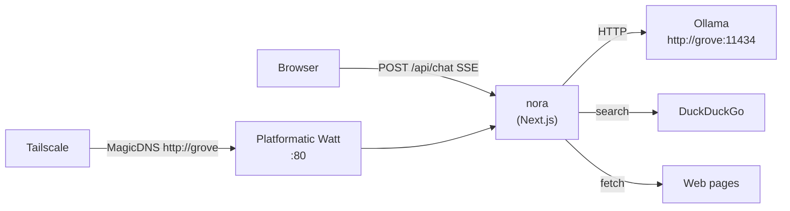
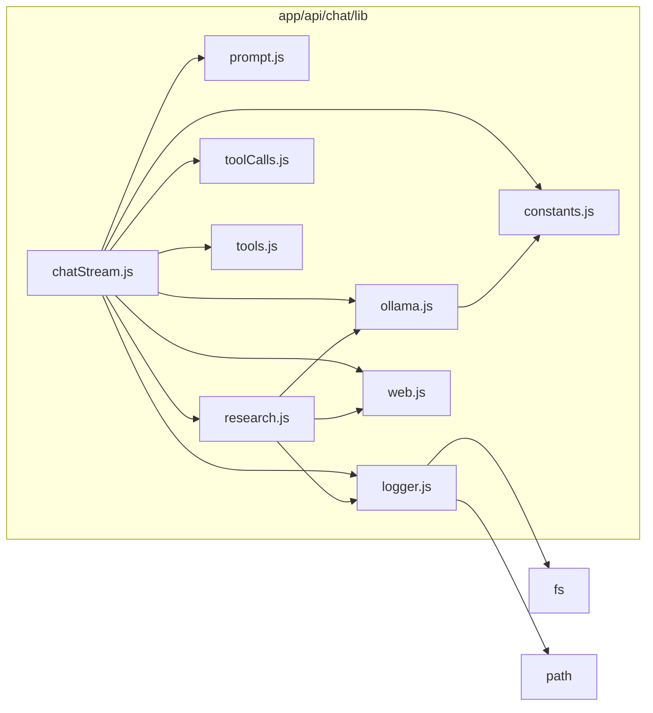

# Nora — Grove Ecosystem Chatbot Design Document

> Living document. Update this file whenever a module boundary, event contract, or tool definition changes.

---

## 1. Overview

Nora is the Grove family's AI-powered house steward — a Next.js 16 chatbot that streams answers from a local Ollama LLM. She can search the web, read specific pages, and call time-related tools — all orchestrated on the server so the browser only deals with a simple Server-Sent Events (SSE) stream.

### System Architecture



---

## 2. Module Map

```
app/
├── page.js                       ← Family dashboard landing page
├── chat/
│   └── page.js                   ← Chat route wrapper; renders `components/ChatWorkspace`
├── modules/
│   ├── page.js                   ← Nora module catalog (educational + household utility)
│   └── [slug]/
│       └── page.js               ← Under-construction placeholder for Nora-native modules
├── api/
│   ├── chat/
│   │   ├── route.js              ← HTTP POST handler (input validation only)
│   │   └── lib/
│   │       ├── constants.js      ← Shared config: model name, window sizes, SSE headers
│   │       ├── tools.js          ← Tool definitions (JSON Schema sent to Ollama)
│   │       ├── prompt.js         ← System prompt injection
│   │       ├── toolCalls.js      ← Tool-call parsing (structured + XML fallback) & argument normalization
│   │       ├── ollama.js         ← Ollama HTTP client + conversation history compression
│   │       ├── web.js            ← Web search, webpage reader, HTML utilities, fallback query builder    │       ├── research.js       ← Deep research engine: multi-angle search + synthesis
    │       ├── logger.js         ← Append-only audit log (logs/chat-audit.log, overwrite per session)│   │       └── chatStream.js     ← Tool-planning loop, streaming orchestration
│   └── models/
│       └── route.js              ← Proxies Ollama /api/tags; returns ordered model list
components/
  ├── HomeDashboard.js              ← Landing dashboard with empty-state cards for any source not yet backed by real data
  ├── ChatWorkspace.js              ← Chat UI; fetches /api/models and /api/chat, controls mobile history overlay state
├── ChatSidebar.js                ← Chat history list; desktop left rail + mobile full-screen overlay
├── ChatMessage.js
└── ChatInput.js
lib/home/
└── dashboard.js                  ← Server-side dashboard data builder (identity + chat-derived profile, no fabricated household data)
lib/modules/
└── registry.js                   ← Nora module registry (`/modules/*`)
```

### Module responsibilities (one per module)

| Module | Responsibility |
|--------|---------------|
| `route.js` | Parse and validate HTTP request body; delegate to `chatStream` |
| `constants.js` | All magic values and env-derived config in one place |
| `tools.js` | Declare tool schemas; nothing else |
| `prompt.js` | Compose the system prompt; inject it into message history, including clock context for search freshness (not as factual evidence) |
| `toolCalls.js` | Extract and normalize tool calls from any model output format |
| `ollama.js` | HTTP transport to Ollama; rolling-window history compression |
| `web.js` | Fetch data from the internet: search, read, fallback query generation |
| `research.js` | Deep research: plan 4 angles, search + read + summarize each, synthesize |
| `logger.js` | Audit log writer; overwrites on process start, appends per request |
| `chatStream.js` | Orchestrate tool-planning loop + final streaming answer |

### Module Dependency Graph

> Auto-generated from source with `yarn arch`. Re-run after adding modules.



---

## 3. Request Lifecycle

```
Browser
  │
  ├─ POST /api/chat  { model, messages }
  │
  └─ route.js
       │  validates input
       └─ chatStream.streamResponse(model, messages)
            │
            ├─ ollama.compressHistory()       ← trim old turns if > 20 messages
            ├─ prompt.withSystemMessage()     ← prepend system instructions
            │
            ├─ planTools() loop (up to 3 passes)
            │    ├─ callOllama(stream: false, think: false, num_predict: 512, tools: [...])
            │    ├─ toolCalls.extractToolCalls()
            │    ├─ if no tool call: run semantic verification-risk classifier (LLM JSON)
            │    ├─ classifier result + fallback heuristics decide whether to force web_search verification
            │    │    ├─ current-role lookups search official-source variants first
            │    │    └─ if only low-confidence result remains: read_webpage that source for primary evidence
            │    └─ for each call:
            │         ├─ get_current_time → Date/Time payload
            │         ├─ web_search      → web.webSearch()
            │         ├─ read_webpage    → web.readWebpage()
            │         │                     ├─ if content > 2000 chars: summarizePage()
            │         │                     └─ on error: web.webSearch(fallback query)
            │         └─ deep_research   → research.deepResearch()
            │                               └─ 4 angles: search → read → summarize → synthesize
            │
            ├─ emit { sources: [...] }
            │
              ├─ verification phase
              │    ├─ buildVerificationReport(userMessage, sourceUrls)
              │    ├─ if status=weak|low_confidence|unverified: run deep_research
              │    ├─ if still weak for sensitive person-status claims: run trusted-outlet searches + read trusted page
              │    ├─ emit { verification: { required, status, sourceCount, reliableSourceCount, highConfidenceSourceCount, trustedSourceCount, guidance } }
              │    └─ if still weak|unverified after escalation: emit guarded refusal and stop
              │
            └─ streamFinalAnswer()
                ├─ callOllama(stream: true, think: false)
                 ├─ emit { thinking } tokens
                 ├─ emit { thinkingDone } on content start
                 ├─ emit { word } tokens
                 └─ emit [DONE]
```

---

## 4. SSE Event Contract

All events are newline-delimited `data: <JSON>` frames on the `/api/chat` stream.

| Event | Shape | When emitted |
|-------|-------|-------------|
| Status | `{ "status": "..." }` | Granular status string throughout pipeline; `null` clears it |
| Searching indicator | `{ "searching": true, "query": "..." }` | Before a web search or fallback fetch starts |
| Search done | `{ "searching": false, "query": "...", "resultCount": N }` | After search completes |
| Researching indicator | `{ "researching": true, "topic": "..." }` | When deep_research tool starts |
| Researching done | `{ "researching": false }` | When deep_research finishes |
| Sources | `{ "sources": ["https://...", ...] }` | Once, after all tool calls finish |
| Verification report | `{ "verification": { "required": bool, "status": "not_required\|verified\|low_confidence\|weak\|unverified", "sourceCount": N, "reliableSourceCount": N, "highConfidenceSourceCount": N, "trustedSourceCount": N, "guidance": "..." } }` | After tool execution, before final answer |
| Thinking token | `{ "thinking": "..." }` | Zero or more; during model reasoning phase |
| Thinking done | `{ "thinkingDone": true }` | Once, when content begins |
| Word token | `{ "word": "..." }` | One per content chunk from Ollama |
| Done | `[DONE]` (literal string) | Stream termination |
| Error | `{ "word": "Error: ..." }` preceded by `{ "thinkingDone": true }` | On any server-side failure |

UI note: the active assistant message keeps a separate thinking bubble visible while streaming and no answer content exists yet. `{ status: "..." }` updates are rendered in that bubble until `{ word: "..." }` tokens begin. The thinking text is displayed in a 3-line scrollable viewport with smooth auto-follow to the latest line unless the user scrolls up.

Mobile note: on small screens, Nora enforces a single-pane layout. The history sidebar is collapsed by default and opens as a full-screen overlay only when explicitly activated.

Composer note: input instructions are rendered below the textarea instead of inside placeholder text so guidance remains readable on narrow screens.

---

## 5. Tool Definitions

Tools live in `lib/tools.js`. Each tool is a JSON Schema object Ollama reads to decide when to call it.

| Tool | Trigger (examples) | Server action |
|------|--------------------|---------------|
| `get_current_time` | "What time is it?", "What's today's date?" | Returns ISO date/time string |
| `web_search` | Current events, prices, software versions, who holds a role | DuckDuckGo instant → HTML fallback, with HTML preferred for official-source queries |
| `read_webpage` | User gives a URL, asks to "read this page" | HTTP fetch + HTML text extraction → fallback search on error |
| `deep_research` | "Why/how/explain/compare" broad questions | 4-angle search: plan queries → search+read+summarize each → synthesize |

### Adding a new tool

1. Add JSON schema to `lib/tools.js` and include it in `TOOL_DEFINITIONS`.
2. Add an `if (fn?.name === 'your_tool')` branch in `chatStream.executeToolCall`.
3. Implement the tool logic in the appropriate module (new file if the concern is new).
4. Update this document's tool table.

---

## 6. Model Configuration

| Variable | Where | Default |
|----------|-------|---------|
| `DEFAULT_MODEL` | `lib/constants.js` via `process.env.DEFAULT_MODEL` | `qwen3.5:9b` |
| `NEXT_PUBLIC_DEFAULT_MODEL` | `app/page.js` client-side initial state | `qwen3.5:9b` |
| `ROLLING_WINDOW` | `lib/constants.js` | 20 messages before compression |
| `RECENT_KEEP` | `lib/constants.js` | 10 messages kept verbatim after compression |
| `MAX_TOOL_PLANNING_PASSES` | `lib/constants.js` | 3 |
| `NORA_DB_PATH` | `lib/db/db.js` via `process.env.NORA_DB_PATH` | `<cwd>/data/nora.db` (container: `/data/nora.db` on Docker volume `nora-data`) |

The `/api/models` route proxies `http://grove:11434/api/tags` and always places `DEFAULT_MODEL` first in the list.

---

## 7. Failure Modes

| Failure | Behaviour |
|---------|-----------|
| Ollama unreachable | SSE error event; UI shows error message |
| Web search returns nothing | Empty results array passed to model; model falls back to training knowledge |
| Webpage blocked (e.g. 503) | `readWebpage` sets `error` field; chatStream runs `buildFallbackWebQuery` → `webSearch` |
| Model loops on tool calls | `MAX_TOOL_PLANNING_PASSES` cap breaks the loop |
| deep_research angle fails | Angle skipped silently; remaining angles still synthesized |
| Model skips tools on semantically high-risk factual/recommendation claim | Server runs semantic verification-risk classifier and forces verification web_search before final answer |
| Sensitive person-status claim (alive/dead/assassinated) only has untrusted outlets | Server keeps searching with trusted-outlet queries and reads a trusted page before deciding; only then may it refuse definitive claims |
| Reasoning-capable model leaks internal chain-of-thought text in final answer | Final streaming pass explicitly sets `think: false` so chat output stays user-facing |
| SQLite DB file missing or directory unwritable at startup | `createDatabase` calls `mkdirSync` with `recursive: true`; if that fails Node throws and Next.js will not start — check `NORA_DB_PATH` and volume mount |
| Only low-confidence source found for current-role question | Server reads the page for primary evidence, marks verification `low_confidence`, and continues verification work rather than trusting the model |
| Verification required but evidence remains low-confidence, weak, or unverified | Server emits guarded "cannot verify confidently" answer and does not stream a definitive claim |

---

## 8. Architecture Decisions

See [`docs/adr/`](./docs/adr/) for individual decision records.

| ID | Decision | Status |
|----|----------|--------|
| ADR-001 | Tool planning in non-streaming first pass | Accepted |
| ADR-002 | Short-circuit when planning pass produces final answer | Deprecated |
| ADR-003 | XML tool-call parsing fallback for non-conforming models | Accepted |
| ADR-004 | Webpage read failure falls back to web search | Accepted |
| ADR-005 | Module split: one responsibility per file | Accepted |
| ADR-006 | Persist SQLite chat history via Docker named volume | Accepted |

---

## 9. Extension Points

- **New tool**: see Section 5.
- **New LLM backend**: replace `lib/ollama.js` `callOllama` and keep the same message protocol.
- **New search provider**: replace `webSearch` / `duckDuckGoHtmlSearch` in `lib/web.js`.
- **History compression strategy**: modify `compressHistory` in `lib/ollama.js`.
- **UI event types**: add a new SSE shape to the contract table in Section 4 and handle it in `components/ChatWorkspace.js`.

---

## 10. Doc Update Checklist

When a code change touches any of the items below, update this document **in the same PR**:

- [ ] New or removed tool → Section 5 tool table
- [ ] New SSE event shape → Section 4 event contract
- [ ] New or changed module → Section 2 module map and responsibilities table
- [ ] New env variable or constant → Section 6
- [ ] New failure mode or recovery path → Section 7
- [ ] Architecture decision made → new ADR file + Section 8 table row


