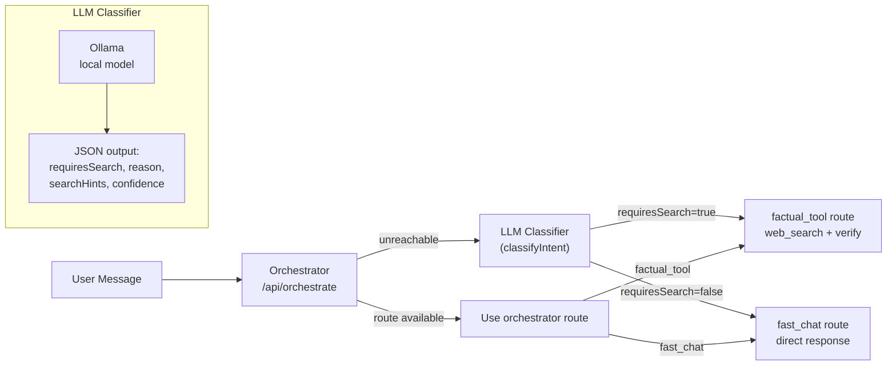

# Intent Classification

## Overview

Nora uses **LLM-based semantic intent classification** to determine whether a user message requires web search/tool verification before answering, or can be answered from general knowledge. This replaces all keyword-based classification systems.

## Architecture



## Classification Pipeline

### 1. Orchestrator Path (Primary)
The orchestrator service (`/orchestrate`) receives the user message and determines routing:
- `factual_tool` — needs web search for current/fresh data
- `fast_chat` — general conversation, no search needed
- `reasoning` — multi-step analysis
- `local_tool` — local device queries (time, date)

### 2. LLM Classifier Path (Fallback)
When the orchestrator is unreachable or no tool calls were planned by the model:

```javascript
import { classifyIntent } from './intent'

const intent = await classifyIntent(model, userMessage)
// Returns: { requiresSearch, reason, searchHints[], confidence }
```

The LLM classifier uses a system prompt that instructs the model to:
- Use **semantic intent understanding**, not keyword matching
- Return strict JSON with `requiresSearch` boolean, confidence level, search hints, and reasoning
- Distinguish between: current events/news (search) vs. general knowledge (no search)

### 3. No Keyword Fallback (Fully Eliminated)
As of May 2026, **all keyword-based intent classification has been completely removed** from the Nora codebase. The functions `requiresFactVerification`, `requiresLiveData`, `requiresPreciseValue`, and all keyword-matching logic have been deleted from:
- `lib/intent.js` — now only contains `classifyIntent()` (LLM-only)
- `lib/orchestratorClient.js` — only imports and calls `classifyIntent()`
- `lib/planTools.js` — only uses `classifyIntent()`, no keyword imports
- `lib/verification.js` — no longer suppresses Wikipedia based on keywords
- `lib/queries.js` — generates generic verification queries, no keyword-based variants like `site:whitehouse.gov`

Classification is now **100% LLM-driven**. There are no keyword fallbacks, no regex-based routing, and no silent keyword matching anywhere in the chat pipeline.

## Classification Rules (from LLM System Prompt)

### requiresSearch = true
- Current events, news, weather, live status updates
- Stock/price/current value queries
- Latest software versions or releases
- Recent sports scores, breaking news
- Current office holders (president, CEO, etc.)
- ANY coding/technical questions about specific libraries, frameworks, APIs
- Factual claims involving dates, numbers, statistics, rankings

### requiresSearch = false
- Casual conversation, greetings
- Creative writing, jokes, rewrites
- General knowledge explanations (timeless)
- Opinions, emotional/social chat
- Analysis questions that don't need current data

### When in doubt → requiresSearch = true

## Files

| File | Role |
|------|------|
| `app/api/chat/lib/intent.js` | LLM classifier (`classifyIntent`) + deprecated keyword functions |
| `app/api/chat/lib/llmCalls.js` | `assessVerificationNeed()` — secondary LLM call for verification assessment |
| `app/api/chat/lib/orchestratorClient.js` | Primary routing via orchestrator; LLM fallback when unreachable |
| `app/api/chat/lib/planTools.js` | Uses `classifyIntent()` when no tool calls are planned by the model |
| `app/api/nora-classify/route.js` | Standalone classification endpoint (for external consumers) |

## Key Guarantees

1. **No keyword matching whatsoever**: All production routing uses LLM semantic classification exclusively. Zero regex or substring-based intent detection exists in the codebase.
2. **LLM determines web search need**: `classifyIntent()` is the sole mechanism for deciding whether a prompt requires up-to-date web search for current information.
3. **Graceful degradation**: When the orchestrator is unreachable, `classifyIntent()` provides LLM-based fallback routing.
4. **Test isolation**: Tests use `TEST_FALLBACK_ROUTE` env var — no message-based classification in test mode.

## Migration Notes

### Complete Elimination of Keyword Classification (May 2026)

All keyword-based intent classification has been **permanently removed** from the Nora chat pipeline. Previously deprecated keyword functions (`requiresFactVerification`, `requiresLiveData`, `requiresPreciseValue`) were deleted entirely.

**Before (partially keyword-based):**
```javascript
// OLD: Used regex/keyword matching to determine if search was needed
const VERIFICATION_KEYWORDS = ['event', 'incident', 'accident', ...]
function requiresFactVerification(text) {
  return VERIFICATION_KEYWORDS.some(kw => new RegExp(`\\b${kw}\\b`).test(text))
}
// This function no longer exists in the codebase.
```

**After (fully LLM-based):**
```javascript
// NEW: 100% LLM semantic classification — only mechanism for routing decisions  
const intent = await classifyIntent(model, userMessage)
// Returns: { requiresSearch: true/false, reason: string, confidence: 'low'|'medium'|'high' }

// The orchestrator also routes via LLM:
const plan = await getExecutionPlan(userMessage)
// Returns route: 'factual_tool' | 'fast_chat' | 'reasoning' | 'local_tool'
```

**Files affected by this change:**
- `lib/intent.js` — only `classifyIntent()` remains, no keyword functions
- `lib/orchestratorClient.js` — only uses `classifyIntent()`, removed keyword imports
- `lib/planTools.js` — only uses `classifyIntent()`, no deprecated functions
- `lib/verification.js` — `suppressWikipedia()` is now a passthrough (no keyword gating)
- `lib/queries.js` — generates generic verification queries for all prompt types

## Related Design Docs

- [modules.md](./modules.md) — Module responsibilities
- [lifecycle.md](./lifecycle.md) — Request lifecycle and tool planning flow
- [failure-modes.md](./failure-modes.md) — Fallback behavior and recovery