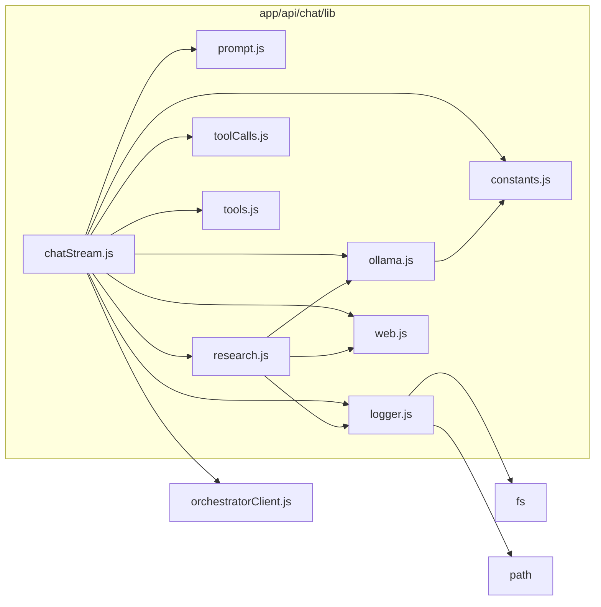

# Modules

## Module Map

```text
app/
├── page.js
├── chat/
│   └── page.js
├── api/
│   ├── chat/
│   │   ├── route.js
│   │   └── lib/
│   │       ├── constants.js
│   │       ├── tools.js
│   │       ├── prompt.js
│   │       ├── orchestratorClient.js
│   │       ├── toolCalls.js
│   │       ├── ollama.js
│   │       ├── web.js
│   │       ├── research.js
│   │       ├── logger.js
│   │       └── chatStream.js
│   ├── nora-crossword/
│   │   └── route.js
│   └── models/
│       └── route.js
components/
├── ChatWorkspace.js
├── ChatSidebar.js
├── ChatMessage.js
└── ChatInput.js
public/
└── (static chat assets)
```

## Responsibilities

| Module | Responsibility |
|--------|---------------|
| `app/page.js` | Redirect root traffic into the dedicated `/chat` experience |
| `route.js` | Parse and validate HTTP request body and delegate to `chatStream` |
| `constants.js` | Shared env/config constants |
| `tools.js` | Tool schemas for model planning |
| `prompt.js` | System prompt composition and injection |
| `orchestratorClient.js` | Call orchestrator `/orchestrate` with safe fallback |
| `toolCalls.js` | Parse and normalize tool calls |
| `ollama.js` | Transport to Ollama and history compression |
| `web.js` | Search and webpage reading helpers |
| `research.js` | Multi-angle deep research pipeline |
| `logger.js` | Append-only audit logging |
| `chatStream.js` | Tool planning and final streaming orchestration |
| `app/api/nora-crossword/route.js` | Generate and validate dense level-based crossword layouts for games |

## Dependency Graph


