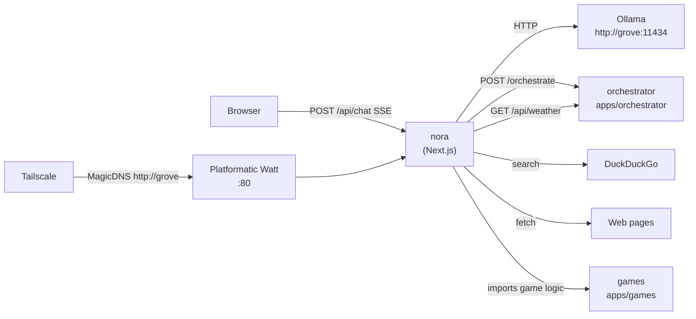

# Overview

Nora is the Grove family's AI-powered house steward built on Next.js 16. It streams responses from a local Ollama model, performs web verification/tool usage, and delegates routing policy to the sibling orchestrator via `POST /orchestrate`.

The weather widget is intentionally separate from prose chat output and uses strict JSON from `/api/weather`.

## System Architecture

