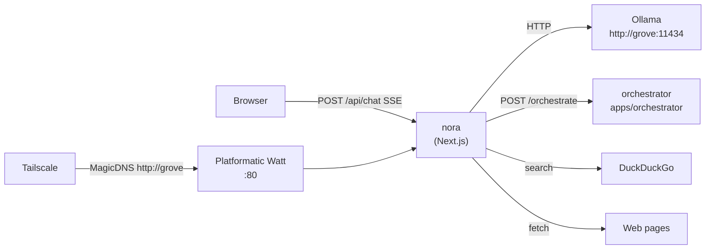

# Overview

Nora is the Grove family's AI-powered chatbot built on Next.js 16. It streams responses from a local Ollama model, performs web verification/tool usage, and delegates routing policy to the sibling orchestrator via `POST /orchestrate`.

## System Architecture

